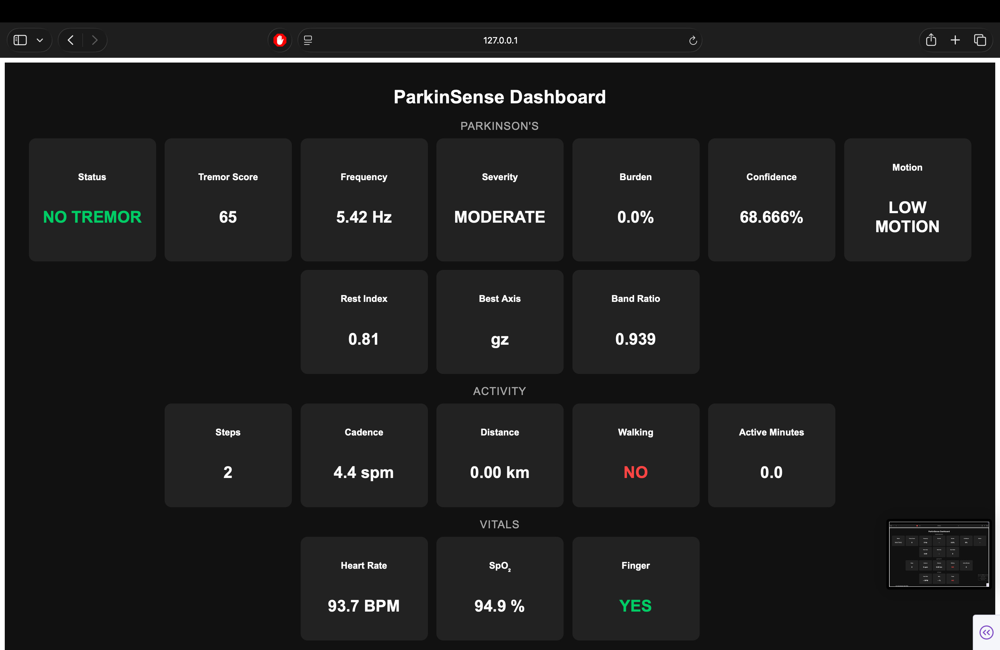
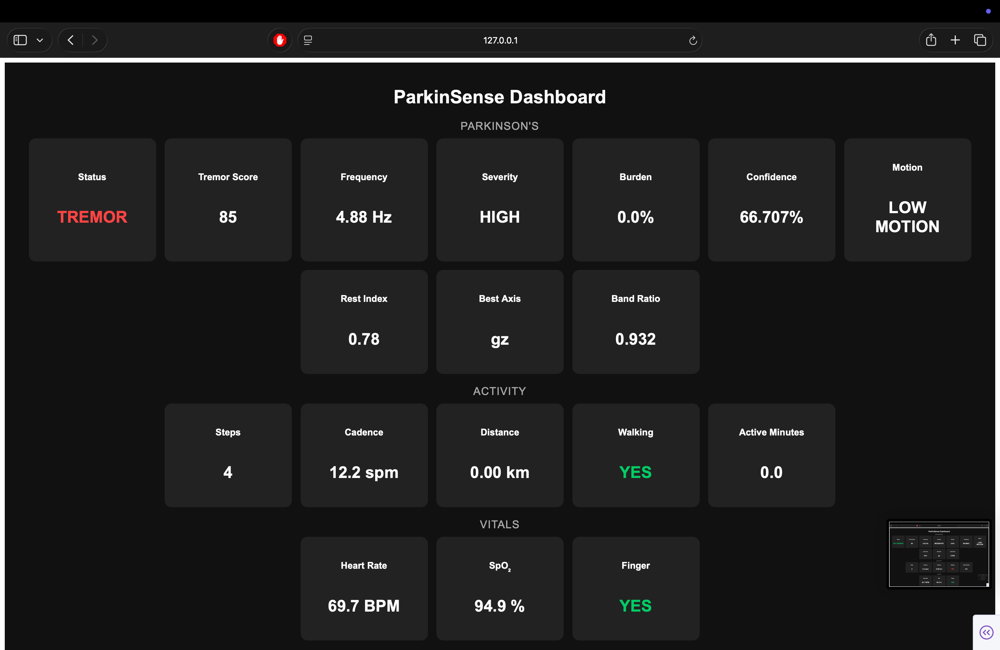
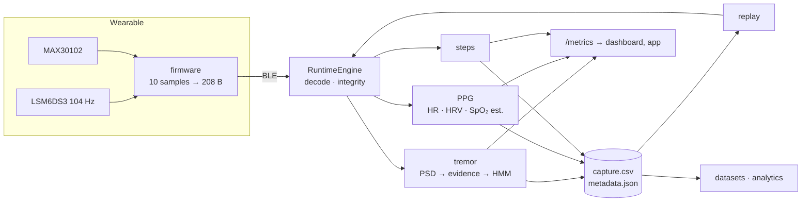

<div align="center">

# ParkinSense

<p><strong>Open research platform for wrist-worn movement and PPG monitoring</strong></p>

*Continuous IMU + PPG sensing on an nRF52840 wearable, streamed over BLE to a reproducible Python
pipeline for tremor, heart-rate and activity biomarkers — with explicit quality states, full
provenance and deterministic replay.*


**Research use only — not a medical device. No output has been clinically validated.**

</div>

---

## Contents

[Overview](#overview) · [Validation status](#validation-status) · [Hardware](#hardware) ·
[Architecture](#architecture) · [Algorithms](#key-algorithms) · [Repository](#repository-structure) ·
[Install](#installation) · [Quick start](#quick-start) · [Testing](#testing) ·
[Documentation](#documentation) · [Limitations](#limitations) · [Contributing](#contributing) ·
[Citation](#citation) · [License](#license)

## Overview

ParkinSense is a wearable research platform for studying Parkinsonian rest tremor and related
digital biomarkers in everyday life. A Seeed XIAO nRF52840 Sense samples a 6-axis IMU at
104 Hz and a finger PPG sensor, packs ten samples per 208-byte BLE notification and streams them
to a Python runtime. The runtime:

* detects rest tremor and measures its **frequency (Hz)** and **amplitude (deg/s)** from the
  gyroscope spectrum, with a probabilistic (HMM) temporal filter;
* classifies motion context (REST / LOW MOTION / ACTIVE) without letting tremor masquerade as
  movement;
* estimates **heart rate** and **HRV** from PPG, flags estimates corrupted by motion, and gives an
  **uncalibrated SpO₂ estimate**;
* counts steps and cadence;
* tags every output with a **quality state** and every recording with the firmware, protocol,
  pipeline and algorithm versions that produced it;
* records every raw sample, so any session can be **replayed bit-exactly** through any pipeline
  version.

| Dashboard — rest | Dashboard — tremor |
|:---:|:---:|
|  |  |

*(Dashboard photos from pipeline 2.x; the 3.0.0 card set is described in [dashboard & API](docs/software/DASHBOARD_AND_API.md).)*

## Validation status

| Capability | Status | Evidence |
|---|---|---|
| BLE acquisition, recording, provenance | working | integration tests; hardware use with firmware v4 |
| Deterministic replay through the live pipeline | working | `test_live_and_replay_are_identical` |
| Rest-tremor detection / frequency / amplitude | working on synthetic ground truth | sensitivity 0.99, specificity 1.00, frequency error 0.024 Hz (synthetic) — **no patient data** |
| Heart rate | working on synthetic ground truth | rest MAE 0.3–0.4 BPM (synthetic); no ECG comparison yet |
| HRV | firmware 5.0.0 only (needs ≥ 25 Hz PPG) | RMSSD MAE 6.7 ms (synthetic) |
| SpO₂ | **uncalibrated estimate** | no reference oximeter data |
| Steps / cadence | working, known false steps during arm movement | −9.7 % walking error (synthetic); 69 vs ≈ 86 on one real recording |
| Datasets with leakage-safe splits | working | unit tests |
| Firmware 5.0.0 / protocol v2 | **written and host-tested, not yet flashed** | [hardware test procedure](docs/validation/HARDWARE_TEST_PROCEDURE.md) |
| Mobile companion app | not in this repository | — |

Before/after numbers and how they were obtained: [validation results](docs/validation/RESULTS.md).

## Hardware

| Component | Part | Notes |
|---|---|---|
| MCU / radio | Seeed XIAO nRF52840 Sense (Cortex-M4F, BLE 5) | |
| IMU | LSM6DS3, I²C 0x6A | firmware 5.0.0: ±4 g, ±500 dps, 104 Hz ODR |
| PPG | MAX30102 (red + IR) | 100 SPS FIFO; ~100 Hz to host with v5, 10 Hz with v4 |
| Power | 3.7 V 700 mAh Li-ion, USB-C charging | no power measurements exist yet |

Streaming is gated on a finger covering the PPG sensor (both firmware versions).
Details: [hardware](docs/hardware/HARDWARE.md) · [firmware](docs/firmware/FIRMWARE.md) ·
[BLE protocol](docs/protocol/BLE_PROTOCOL.md).

## Architecture



Two clocks: per sample (104 Hz) for buffering, PPG ingestion, steps and recording; per analysis
(every 0.5 s over a 4 s window) for tremor and PPG analysis. All temporal logic runs on device
signal time, which is why live and replayed results are identical.
More: [architecture](docs/architecture/ARCHITECTURE.md) · [runtime](docs/runtime/RUNTIME_AND_RECORDING.md).

## Key algorithms

| Area | Method | Doc |
|---|---|---|
| Tremor spectrum | Welch PSD per gyro axis (2 s Hann, 50 % overlap, nfft 1024), summed over axes | [motion & tremor](docs/algorithms/MOTION_AND_TREMOR.md) |
| Frequency | 3.5–7.5 Hz peak, Gaussian (log-parabolic) interpolation | 〃 |
| Amplitude | √(power within ±0.625 Hz) in deg/s RMS | 〃 |
| Rejection | SNR vs spectral floor, band-edge check, arm-swing harmonic check | 〃 |
| Motion context | 0.2–3 Hz linear acceleration + 0.5–3 Hz gyro RMS (tremor band excluded) | 〃 |
| Temporal | 2-state HMM forward filter, rate-based transitions, overlap-tempered evidence | 〃 |
| Heart rate | 0.5–4.5 Hz band-pass, peak detection with dicrotic-notch guard, median RR, EMA | [PPG](docs/algorithms/PPG.md) |
| Motion artefact | confidence × motion multiplier; flag when HR ≈ motion frequency or 2× | 〃 |
| HRV | RMSSD, SDNN, pNN50; withheld below 25 Hz effective PPG rate | 〃 |
| Steps | adaptive-threshold peak detector with hysteresis, refractory and motion gate; tremor guard | [activity](docs/algorithms/ACTIVITY.md) |
| Aggregates | tremor time %, tremor power (ParaDigMa definitions); robust personal baselines | [biomarkers](docs/biomarkers/BIOMARKERS.md) |

## Repository structure

```text
parkinsense/            Python package
  protocol/             BLE packet decode/encode (v1, v2), unwrap, loss/gap tracking
  motion/  tremor/      filters, spectral features, motion context, tremor evidence, HMM
  ppg/                  PPG processor (state, quality) and algorithms (DSP)
  activity/             step counter (default) + experimental periodic counter
  runtime/              engine (pure), recorder (files), app (BLE + FastAPI)
  replay/  datasets/    deterministic replay; dataset builder; leakage-safe splits
  analytics/            session biomarkers; personal baselines
  synthetic/            ground-truth signal generators
  visualization/        Dash dashboard
firmware/
  parkinsense_wearable/ firmware 5.0.0, protocol v2 (not yet hardware-verified)
  legacy/               ble_stream_v4 (protocol v1, hardware-verified) and older sketches
  tests/                host tests for packet logic; API stubs
tests/                  unit · integration · regression (golden) · synthetic · hardware
benchmarks/             baseline-vs-current harness and committed results
data/reference/         real recordings used by the regression tests
docs/                   documentation (index: docs/README.md)
```

## Installation

```bash
git clone https://github.com/sudo-pranshu/ParkinSense.git && cd ParkinSense
git checkout transform/engineering-overhaul
python -m venv .venv && source .venv/bin/activate
pip install -e ".[live,dashboard,dev]"
```

Firmware: Arduino IDE 2.x with the Seeed nRF52 (Bluefruit-based) core, *Seeed Arduino LSM6DS3*
and *SparkFun MAX3010x* libraries. Use `firmware/legacy/ble_stream_v4` for data collection until
`firmware/parkinsense_wearable` passes hardware tests H0–H6.
Full guide: [installation](docs/getting-started/INSTALLATION.md).

## Quick start

```bash
parkinsense-live                                     # scan, connect, record to recordings/, serve :8000/metrics
python -m parkinsense.visualization.dashboard        # http://127.0.0.1:8050

parkinsense-replay recordings/<session>/capture.csv --out replays/a
parkinsense-replay data/reference/ble_v1_104hz/parkinsense_20260630_123551.csv   # no hardware needed
parkinsense-dataset recordings/*/capture.csv --out datasets/v1 --version 1.0.0
```

Each session directory holds `capture.csv` (79 columns, every raw sample plus window outputs
marked by `is_analysis_row`) and `metadata.json` (versions, configuration, measured sample rate,
packet loss, wraps, gaps, errors).

## Testing

```bash
pytest                                                           # 64 passed, 1 deselected (hardware)
python -m benchmarks.run_benchmarks --impl current --out benchmarks/results/current.json
```

Unit, integration (incl. live == replay), golden regression on real recordings, synthetic
performance floors and firmware host tests run in CI. Guide: [testing](docs/testing/TESTING.md).

## Documentation

**[Documentation index](docs/README.md)** — installation · architecture · hardware · firmware ·
BLE protocol · Python packages · runtime & capture schema · dashboard & API · replay & datasets ·
algorithms with equations · biomarkers · testing · hardware validation · contributing ·
decision records · references · reports.

## Limitations

* All accuracy figures come from synthetic signals or a few unlabelled recordings; tremor
  detection has never been evaluated on people with Parkinson's disease.
* Physiological and pathological tremor cannot be separated from frequency and amplitude alone.
* Tremor confirmation takes ~6 s from onset (deliberate, to suppress false alarms).
* Heart rate during rhythmic movement is often wrong — flagged `MOTION_ARTIFACT`, not corrected.
* Purposeful arm movement produces false steps.
* Firmware ≤ v4: PPG effectively 10 Hz (no HRV), gyro wraps above 250 dps.
* Streaming requires a finger on the PPG sensor, which rules out tremor-only and overnight use.
* No power measurements exist for any firmware.
* `STEP_COUNTER_VERSION` in recordings reads `2.0` although the default counter is v1.1
  (known provenance bug, see [audit](docs/audit/DOCUMENTATION_AUDIT_REPORT.md)).

## Contributing

Read [contributing](docs/development/CONTRIBUTING.md): signal time only, no I/O in processing,
quality states for new outputs, append-only schema, versioned protocol, benchmark before replacing
an algorithm, and an ADR for every interpretation-changing decision.

## Research references

Method sources (ParaDigMa, Welch, Gaussian peak interpolation, HMM filtering, TROIKA, HRV Task
Force, Verisense) and evaluated open-source projects with verified licences:
[references](docs/research/REFERENCES.md). The original paper is in
[`docs/research/`](docs/research/ParkinSense_paper.pdf).

## Citation

```bibtex
@misc{parkinsense2026,
  author       = {Pranshu Kumar},
  title        = {ParkinSense: Open Research Platform for Wrist-Worn Movement and PPG Monitoring},
  year         = {2026},
  howpublished = {\url{https://github.com/sudo-pranshu/ParkinSense}}
}
```

## License

MIT — see [LICENSE](LICENSE).

## Disclaimer

ParkinSense is a research and education platform. It is not a medical device and must not be used
for diagnosis, treatment or clinical decisions.
