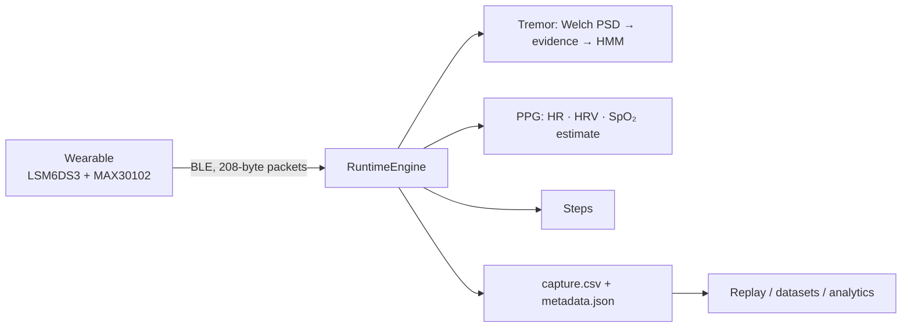

<div align="center">

# ParkinSense

### Open research platform for wrist-worn movement and PPG monitoring


**Research use only. Not a medical device. No output has been clinically validated.**

</div>

ParkinSense streams 104 Hz inertial data and finger PPG from a wrist-worn nRF52840 board over
BLE to a Python runtime that detects rest tremor, measures its frequency and amplitude, counts
steps, and estimates heart rate and HRV — each with an explicit measurement-quality state.
Every session is recorded with full provenance and can be replayed deterministically through
the same code.

## What works today

| Area | Status | Evidence |
|---|---|---|
| BLE acquisition, recording, provenance | working | integration tests; hardware use with firmware v4 |
| Deterministic replay through the live pipeline | working | `test_live_and_replay_are_identical` |
| Rest-tremor detection, frequency, amplitude | working on synthetic ground truth | sensitivity 0.99, specificity 1.00 (synthetic) — **no patient data** |
| Heart rate (finger PPG) | working on synthetic ground truth | rest MAE 0.3–0.4 BPM (synthetic) |
| HRV | only with v2 firmware (≥ 25 Hz PPG) | RMSSD MAE 6.7 ms (synthetic, v2 path) |
| SpO₂ | **uncalibrated estimate** | no reference oximeter data |
| Steps / cadence | working, known false steps during arm movement | walking error −10 % (synthetic); 69 vs ≈86 on one real recording |
| Dataset builder with leakage-safe splits | working | tests |
| Firmware 5.0.0 / protocol v2 | written and host-tested, **not yet flashed** | `docs/validation/HARDWARE_TEST_PROCEDURE.md` |
| Mobile companion app | maintained outside this repository | — |

Full before/after numbers: [`docs/validation/RESULTS.md`](docs/validation/RESULTS.md).
Engineering report: [`docs/audit/TRANSFORMATION_REPORT.md`](docs/audit/TRANSFORMATION_REPORT.md).

## Quick start

```bash
pip install -e ".[live,dashboard,dev]"
pytest                                   # 60+ tests, no hardware needed

parkinsense-live                         # scan, connect, record to recordings/, serve :8000/metrics
python -m parkinsense.visualization.dashboard    # http://127.0.0.1:8050

parkinsense-replay recordings/<session>/capture.csv --out replays/a
parkinsense-dataset recordings/*/capture.csv --out datasets/v1 --version 1.0.0
python -m benchmarks.run_benchmarks --impl current --out benchmarks/results/current.json
```

Firmware: open `firmware/parkinsense_wearable/parkinsense_wearable.ino` in the Arduino IDE
(Seeed nRF52 core, `Seeed_Arduino_LSM6DS3`, `SparkFun MAX3010x`). The last hardware-verified
build is `firmware/legacy/ble_stream_v4`. Both are supported by the host.

## How it works



* **Tremor** — per 4 s window (0.5 s hop): summed-axis gyro spectrum, interpolated 3.5–7.5 Hz
  peak, amplitude in deg/s, peak SNR, band-edge and movement-harmonic rejection; movement
  context computed from non-tremor-band motion only; a two-state HMM turns window evidence
  into a posterior probability and the published classification. No clinical severity score is
  produced. [ADR-0005](docs/decisions/0005-motion-spectral-features.md), [ADR-0007](docs/decisions/0007-tremor-hmm.md)
* **PPG** — analysed at the true slot rate, motion-aware confidence, detection of heart-rate
  estimates locked onto the motion frequency, HRV withheld when the PPG sampling is too coarse.
  [ADR-0008](docs/decisions/0008-ppg-rate-and-quality.md)
* **Quality** — every biomarker carries a state: `VALID`, `LOW_CONFIDENCE`, `MOTION_ARTIFACT`,
  `NO_CONTACT`, `INSUFFICIENT_DATA`, `DATA_GAP`, `SENSOR_FAULT`, `RATE_INVALID`.
* **Integrity** — timestamp unwrap (32-bit micros wraps every 71.6 min), packet loss (v2
  sequence numbers; timestamp gaps for v1), measured vs nominal sample rate, gap resets.

## Repository

```
parkinsense/          Python package
  protocol/           BLE packet decode/encode (v1, v2), integrity trackers
  motion/ tremor/     spectral features, motion context, tremor evidence, HMM
  ppg/                PPG processor and algorithms
  activity/           step counter (default) + experimental periodic counter
  runtime/            engine (pure), recorder, live BLE/API app
  replay/ datasets/   deterministic replay, dataset builder, leakage-safe splits
  analytics/          session biomarkers, personal baselines
  synthetic/          ground-truth signal generators
  visualization/      Dash dashboard
firmware/
  parkinsense_wearable/   firmware 5.0.0, protocol v2 (not yet hardware-verified)
  legacy/                 ble_stream_v4 (protocol v1, hardware-verified) and older sketches
  tests/                  host unit tests for packet logic
tests/                unit · integration · regression (golden, real recordings) · synthetic · hardware
benchmarks/           baseline-vs-current harness and results
data/reference/       real recordings used by regression tests
docs/                 architecture · protocols · decisions (ADRs) · validation · research · references · audit
```

## Documentation

[Architecture](docs/architecture/ARCHITECTURE.md) ·
[BLE protocol](docs/protocols/BLE_PROTOCOL.md) ·
[Replay & datasets](docs/validation/REPLAY_AND_DATASETS.md) ·
[Results](docs/validation/RESULTS.md) ·
[Hardware test procedure](docs/validation/HARDWARE_TEST_PROCEDURE.md) ·
[Biomarker feasibility](docs/research/BIOMARKER_FEASIBILITY.md) ·
[Open-source references](docs/references/OPEN_SOURCE_REFERENCES.md) ·
[Decision records](docs/decisions/README.md)

## Known limitations

* All accuracy numbers are on synthetic signals or a handful of unlabelled real recordings.
  Tremor detection has never been evaluated on people with Parkinson's disease.
* Physiological and pathological tremor cannot be told apart from frequency and amplitude
  alone; a real 6–7 Hz oscillation in a healthy wearer is reported as tremor.
* Tremor confirmation takes ~6 s from onset (the previous version took ~1 s with more false
  positives).
* Heart rate during rhythmic movement is often wrong; it is flagged `MOTION_ARTIFACT`, not
  corrected.
* Purposeful arm movement produces false steps.
* With firmware ≤ v4 the PPG is effectively sampled at 10 Hz (no HRV), gyro wraps above
  250 deg/s, and the device streams only while a finger is on the PPG sensor.
* No power measurements exist for any firmware; earlier battery-life figures were removed.

## Citation

```bibtex
@misc{parkinsense2026,
  author       = {Pranshu Kumar},
  title        = {ParkinSense: Open Research Platform for Wrist-Worn Movement and PPG Monitoring},
  year         = {2026},
  howpublished = {\url{https://github.com/sudo-pranshu/ParkinSense}}
}
```

## License

MIT — see [LICENSE](LICENSE).

## Disclaimer

ParkinSense is a research and education platform. It is not a medical device and must not be
used for diagnosis, treatment or clinical decisions.
