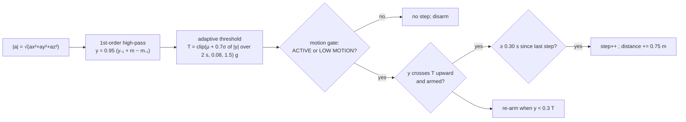

# Activity: step counting

Default: [`activity/step_counter.py`](../../parkinsense/activity/step_counter.py) (v1 detection
logic, "v1.1" with the changes below). Experimental: [`activity/step_counter_periodic.py`](../../parkinsense/activity/step_counter_periodic.py).
Tests: [`tests/unit/test_activity_and_splits.py`](../../tests/unit/test_activity_and_splits.py),
`test_no_steps_during_rest_tremor`, `test_steps_are_per_sample_not_forward_filled`.
Decision: [ADR-0009](../decisions/0009-step-counter-acceptance.md).

> **Known discrepancy.** `config.STEP_COUNTER_VERSION` is `"2.0"`, but the default algorithm is
> the v1 detector (v1.1). Recordings made with pipeline 3.0.0 therefore carry an incorrect step
> counter version in `metadata.json` and the capture. Reported in
> [the documentation audit](../audit/DOCUMENTATION_AUDIT_REPORT.md); not changed in this
> documentation-only pass.

## Default counter (per sample, 104 Hz)

| Element | Definition |
|---|---|
| high-pass | $y_n = 0.95\,(y_{n-1} + m_n - m_{n-1})$, cutoff ≈ $f_s(1-0.95)/2\pi$ ≈ 0.83 Hz |
| threshold | $T = \mathrm{clip}(\mu + 0.7\,\sigma,\ 0.08,\ 1.5)$ over the last 2 s of $\lvert y\rvert$ |
| hysteresis | armed → step on upward crossing of $T$; re-armed when $y < 0.3\,T$ |
| refractory | 60 / 200 steps/min = 0.30 s |
| walking | ≥ 3 consecutive steps each within 60/60 = 1 s; ends 2 s after the last step |
| cadence | $60/\overline{\Delta t}$ over the last 8 step times, EMA α 0.3 |
| distance | steps × 0.75 m (configurable `step_length_m`) |
| active minutes | a walking bout counts after ≥ 60 s at cadence > 60 spm |
| step confidence | clip((y − T)/T) at the step |
| walking confidence | clip(1 − CV of step intervals) |

### Changes in v1.1 (detection logic unchanged)

* `now` = **signal time** from the runtime. v1.0 used host arrival time, so the 10 samples of a
  BLE packet shared one timestamp and intervals were quantised to ~96 ms.
* `break_continuity()` on data gaps (ends the bout, keeps totals).
* Returns canonical `walking_state` (`WALKING` / `NOT_WALKING`).
* Motion state parsed via `MotionState` (both `LOW MOTION` and `LOW_MOTION` accepted).
* **Tremor guard** in the runtime: while a *rest* tremor is confirmed, the counter receives
  `REST` as its gate. Rest-tremor false steps: 23/min → 0.3/min (synthetic).

### Measured behaviour

| | Value | Data |
|---|---|---|
| walking count error | −9.7 % mean (worst −21 %) | synthetic shoulder-pendulum walking, 16 seeds × 60 s |
| false steps, purposeful arm movement | ~49 / min | synthetic |
| real `walking_60s` | 69 steps (≈ 86 expected from 1.35 Hz spectral cadence over 64 s) | 23 Hz log, resampled |
| real `normal_motion_60s` | 90 false steps | 23 Hz log, resampled |

## Experimental periodicity-gated counter

Band-pass 0.5–3 Hz (4th-order causal biquads) on |a|; local maxima above
max(0.05 g, 0.7 × running RMS, τ = 2 s); 0.30 s refractory; a bout is confirmed when 6
consecutive candidates have intervals in 0.30–1.25 s with CV ≤ 0.30 **and** the normalised
autocorrelation at the step or stride lag is ≥ 0.6 (Moe-Nilssen & Helbostad 2004); the whole run
is then counted retroactively (Verisense-style continuity). Within a bout, a step is accepted if
its interval is within ±50 % of the bout median.

Synthetic: walking error ≈ −7 %, false steps 4–12 / min. Real `walking_60s`: 13–43 steps across
settings — **failed acceptance**. Enable with `RuntimeEngine(step_counter="periodic")` for
research only.

## Limitations

Single wrist sensor: arm movement without walking produces candidate peaks; walking with a
still arm (carrying objects) may under-count. Fixing either needs labelled real recordings.
