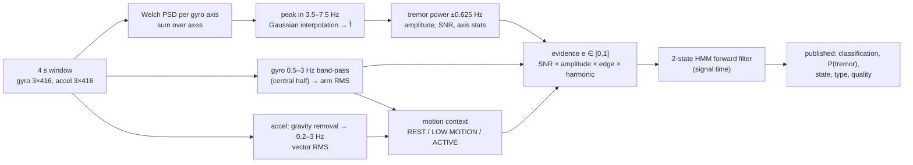

# Motion and tremor algorithms (tremor algorithm v3.0, pipeline 3.0.0)

Implementation: [`motion/features.py`](../../parkinsense/motion/features.py),
[`motion/context.py`](../../parkinsense/motion/context.py),
[`motion/filters.py`](../../parkinsense/motion/filters.py),
[`tremor/detector.py`](../../parkinsense/tremor/detector.py),
[`tremor/temporal.py`](../../parkinsense/tremor/temporal.py),
[`motion/pipeline.py`](../../parkinsense/motion/pipeline.py).
Tests: [`tests/unit/test_features_and_detector.py`](../../tests/unit/test_features_and_detector.py),
[`tests/unit/test_temporal.py`](../../tests/unit/test_temporal.py),
[`tests/synthetic/test_performance_floor.py`](../../tests/synthetic/test_performance_floor.py).
Decisions: [ADR-0005](../decisions/0005-motion-spectral-features.md), [ADR-0007](../decisions/0007-tremor-hmm.md).

> **Validation status.** Every number in this document was obtained on synthetic signals or
> unlabelled recordings. The detector has never been evaluated on people with Parkinson's
> disease. Parameters are engineering settings, not values fitted to patient data.

## 1. Sampling assumptions

| Symbol | Value | Source |
|---|---|---|
| $f_s$ | 104 Hz nominal (firmware interval 9 615 µs = 104.004 Hz) | `config.SAMPLE_RATE_HZ` |
| Window $N$ | 416 samples = 4 s | `config.WINDOW_SAMPLES` |
| Hop $H$ | 52 samples = 0.5 s (87.5 % overlap) | `config.ANALYSIS_HOP_SAMPLES`, ADR-0001 |
| Nyquist | 52 Hz | — |
| Analysed band | 0.5–15 Hz | `config.ANALYSIS_BAND_HZ` |

The runtime **measures** the true device rate from packet timestamps and marks windows invalid
if it deviates by more than 5 % (spectral frequencies scale with the rate error). Anti-aliasing:
with firmware 5.0.0 the IMU's ODR equals 104 Hz, so the sensor's internal digital filter is
the anti-alias stage; firmware v4 sampled a 416 Hz-ODR sensor at 104 Hz without decimation
filtering (content 52–208 Hz may alias).

## 2. Spectral estimate

For each gyroscope axis $a \in \{x,y,z\}$, the window is mean-removed and a Welch
periodogram is computed (`scipy.signal.welch`):

| Parameter | Value |
|---|---|
| Segment length $L$ | $\min(N, \mathrm{round}(2 f_s)) = 208$ samples (2 s) |
| Overlap | $L/2 = 104$ → $K = 3$ segments per 4 s window |
| Window | Hann |
| Per-segment detrend | linear |
| FFT length | 1024 (zero-padded) |

$$P_a(f) = \frac{2}{K\, f_s \sum_n w[n]^2}\sum_{k=1}^{K}\Big|\sum_{n=0}^{L-1} w[n]\,x_{a,k}[n]\,e^{-j2\pi f n/f_s}\Big|^2$$

Bin spacing $\Delta f = f_s/1024 = 0.1016$ Hz. The *resolution* is set by the 2 s segment:
native bin spacing $f_s/L = 0.5$ Hz, Hann −3 dB main-lobe width ≈ 0.72 Hz; zero-padding only
interpolates between those.
The orientation-independent spectrum is the axis sum $S(f)=\sum_a P_a(f)$ (as in ParaDigMa).

The gyroscope is **not band-passed** before this step. v2 band-passed it to 3–8 Hz first,
which made the band ratio $\approx 1$ for almost any input (ADR-0005).

## 3. Tremor peak frequency

Search band $\mathcal{B}_T = [3.5, 7.5]$ Hz (`config.TREMOR_BAND_HZ`; PD rest tremor is typically
4–6 Hz). Peak bin $i^* = \arg\max_{f_i\in\mathcal{B}_T} S(f_i)$, refined by Gaussian
(log-parabolic) interpolation:

$$\alpha=\ln S_{i^*-1},\;\beta=\ln S_{i^*},\;\gamma=\ln S_{i^*+1},\qquad
\delta = \tfrac12\,\frac{\alpha-\gamma}{\alpha-2\beta+\gamma}\in[-\tfrac12,\tfrac12],\qquad
\hat f = f_{i^*} + \delta\,\Delta f$$

If the curvature $\alpha-2\beta+\gamma \ge 0$ (no local maximum) or the peak is at the array edge,
$\hat f = f_{i^*}$. For a Hann window this reduces peak-location bias to a small fraction of a
bin (Jacobsen & Kootsookos 2007; Gasior & Gonzalez 2004).
Measured: |error| < 0.06 Hz for clean sinusoids at 3.9–6.9 Hz (`test_frequency_interpolation_accuracy`);
median 0.024 Hz on the synthetic suite vs 0.090 Hz for v2.

## 4. Tremor power, amplitude, SNR

$$P_T = \sum_{|f_i-\hat f|\le 0.625} S(f_i)\,\Delta f \quad[(\mathrm{deg/s})^2],\qquad
A_T = \sqrt{P_T}\quad[\mathrm{deg/s\ RMS}]$$

The ±0.625 Hz integration width follows ParaDigMa. $A_T$ is the published
`tremor_amplitude_dps` — a physical quantity (Elble & McNames 2016), not a severity score.
For a pure sinusoid of peak amplitude $a$ on one axis, $A_T \approx a/\sqrt2$
(`test_amplitude_in_physical_units`, ±8 %).

Noise floor and SNR:
$$F = \mathrm{median}\{S(f_i): 2\le f_i\le 12,\ |f_i-\hat f|>1\},\qquad
\mathrm{SNR_{dB}} = 10\log_{10}\frac{S(f_{i^*})}{F}$$

Other features:

| Feature | Definition |
|---|---|
| `total_power` $P_{tot}$ | $\sum_{0.5\le f\le 15} S\,\Delta f$ |
| `band_ratio` | $P_T/P_{tot}$ |
| `spectral_entropy` | $-\sum p_i\ln p_i/\ln M$, $p_i = S_i/\sum S$ over 0.5–15 Hz ($M$ bins), 0 = pure tone, 1 = flat |
| `spectral_centroid_hz` | $\sum f_i S_i / \sum S_i$ over 0.5–15 Hz |
| per-axis tremor power $P_{T,a}$ | same ±0.625 Hz window on $P_a$ |
| `best_axis` | $\arg\max_a P_{T,a}$ |
| `axis_dominance` | $\max_a P_{T,a}/\sum_a P_{T,a}$ |
| axis peak $\hat f_a$ | interpolated peak of $P_a$ in $\mathcal{B}_T$ |
| `frequency_std` $\sigma_f$ | weighted std of $\hat f_a$, weights $w_a = P_{T,a}/\sum P_{T,a}$ (noise axes barely vote) |
| `axis_agreement` | $\mathrm{clip}(1-\sigma_f/2,\,0,\,1)$ |

## 5. Purposeful arm movement

$$\tilde g_a = \mathrm{BP}_{0.5\text{–}3\,\mathrm{Hz}}(g_a - \bar g_a),\qquad
P_{arm} = \sum_a \frac{1}{|\mathcal{C}|}\sum_{n\in\mathcal{C}} \tilde g_a[n]^2,\qquad A_{arm}=\sqrt{P_{arm}}$$

BP = 4th-order Butterworth band-pass (8th-order response after zero-phase `sosfiltfilt`).
$\mathcal{C}$ = central half of the window ($n\in[N/4, 3N/4)$). Measured in the time domain, not
from $S(f)$: Hann leakage and amplitude-modulation sidebands of a strong 4–6 Hz tremor
otherwise appear as "movement", and filter start-up transients at the window edges are large
when a strong carrier is present. The dominant movement frequency $f_{arm}$ is the interpolated
peak of $S$ in 0.5–3 Hz. Published as `arm_movement_rms_dps`.

## 6. Motion context

Implementation: `MotionContext.classify`.

1. Gravity removal: $\ell = a - \mathrm{LP}_{0.3\,\mathrm{Hz}}(a)$ (2nd-order Butterworth, zero-phase).
2. Band-limit $\ell$ to 0.2–3 Hz (4th-order, zero-phase) — excludes the tremor band.
3. Central half only; $R_{acc} = \sqrt{\frac{1}{|\mathcal C|}\sum_{n}\lVert\ell[n]\rVert^2}$ (RMS of the vector magnitude, published as `motion_rms`).

| | REST | LOW MOTION | ACTIVE |
|---|---|---|---|
| Accelerometer $R_{acc}$ (g) | < 0.03 | 0.03–0.20 | ≥ 0.20 |
| Gyroscope $A_{arm}$ (deg/s) | < 10 | 10–30 | ≥ 30 |

State = the more active of the two. Accelerometer thresholds are the v2 values (now applied to
band-limited data); gyroscope thresholds were set so synthetic postural micro-motion (~1 deg/s)
is REST and purposeful movement (25–140 deg/s RMS) is ACTIVE. v2 used broadband acceleration,
so strong tremor classified itself ACTIVE and was vetoed (38 % detection of 120–250 deg/s tremor
→ 97 % now).

`rest_index` (legacy display field) $=\max(0, 1 - R_{acc}/0.20)$.

## 7. Per-window tremor evidence

$$\sigma(x)=\frac{1}{1+e^{-x}},\qquad
e = \sigma\!\left(\frac{\mathrm{SNR_{dB}}-10}{2}\right)\cdot
    \sigma\!\left(\frac{A_T-1.0}{0.25}\right)\cdot
    \mathbb{1}[\neg\,\mathrm{edge}]\cdot
    \begin{cases}0.15 & \text{harmonic}\\ 1 & \text{otherwise}\end{cases}$$

| Term | Rule | Rationale |
|---|---|---|
| edge | $\hat f \le 3.65$ or $\hat f \ge 7.35$ Hz | a maximum on the band edge is the skirt of an out-of-band oscillation (9 Hz physiological tremor, 15 Hz vibration) |
| harmonic | $A_{arm}\ge 10$, $f_{arm}>0.3$, $k=\mathrm{round}(\hat f/f_{arm})\in\{2,3,4\}$ and $\lvert\hat f - k f_{arm}\rvert\le 0.15$ Hz | arm-swing harmonics while walking |
| SNR midpoint | 10 dB, width 2 dB | narrow-band oscillation present |
| amplitude midpoint | 1.0 deg/s RMS, width 0.25 | above sensor + postural noise |

`tremor_window_detected` = $e\ge 0.5$; `tremor_score` = round(100 e) (legacy column, now this
evidence). `tremor_type` = `ACTION` if the context is ACTIVE, else `REST` (only when the
published state is tremor).

**These are not calibrated probabilities.** The logistic midpoints were chosen on synthetic data
and checked against the in-repo recordings.

## 8. Temporal inference — HMM forward filter

Hidden state $s_t\in\{0,1\}$ (no tremor / tremor). With $\Delta t$ = signal time since the previous
window (4 s for the first window):

$$q_{in}=1-e^{-\Delta t/\tau_{in}},\quad q_{out}=1-e^{-\Delta t/\tau_{out}},\qquad
p^- = p_{t-1}(1-q_{out}) + (1-p_{t-1})\,q_{in}$$

$$\Lambda = \mathrm{clip}\!\left(\frac{e+\varepsilon}{1-e+\varepsilon},\ \Lambda_{max}^{-1},\ \Lambda_{max}\right)^{\min(1,\ \Delta t/4\,\mathrm{s})},\qquad
p_t = \frac{\Lambda p^-}{\Lambda p^- + 1 - p^-}$$

| Parameter | Value | Meaning |
|---|---|---|
| $p_0$ | 0.02 | prior |
| $\tau_{in}$, $\tau_{out}$ | 120 s, 60 s | entry / exit time constants (rates, so hop-independent) |
| $\Lambda_{max}$ | 60 | max evidence from one *independent* 4 s window |
| tempering exponent | $\Delta t/4$ s | consecutive windows share 87.5 % of samples and are not independent |
| $\varepsilon$ | $10^{-3}$ | |
| confirm / release | $p\ge0.8$ / $p\le0.2$ | hysteresis on the published decision |

Unusable windows (rate invalid, > 2 % clipped samples) update with the prediction only
($p_t = p^-$).

Worked example with full evidence ($e=1$): first window $\Delta t=4$: $p^-=0.0509$,
$\Lambda=60$ → $p=0.763$ (not yet confirmed). Next hop $\Delta t=0.5$: $\Lambda=60^{0.125}=1.67$ →
$p=0.839$ → **confirmed**. So confirmation needs the first full window plus ~0.5 s of continued
evidence; a single 4 s burst cannot confirm by itself. Measured onset latency from true onset
(including window fill): median 6.1 s; offset 8.1 s (synthetic).

State names (legacy-compatible): `NO_TREMOR` ($p\le0.2$, not confirmed), `POSSIBLE_TREMOR`
($p>0.2$, not confirmed), `CONFIRMED_TREMOR` (confirmed, $p\ge0.8$), `RECOVERY` (confirmed,
$p<0.8$).

Published fields: `classification` = `TREMOR` iff confirmed; `confidence` = 100 p;
`tremor_probability` = p; `severity` = `NOT_ASSESSED` when tremor, else `NONE` (no clinical
severity is produced); `tremor_quality` = `LOW_CONFIDENCE` if confirmed with $p<0.95$, else the
window quality (`VALID`, `DATA_GAP`, `SENSOR_FAULT`).

Tests: `test_confirms_and_releases`, `test_hop_invariance` (0.25/0.5/1 s hops confirm within
1.6 s of each other; the v2 state machine's latency scaled linearly with the hop),
`test_no_dead_band_lockup` (v2 froze in CONFIRMED for scores 56–74).

## 9. Session aggregation

See [biomarkers](../biomarkers/BIOMARKERS.md): tremor time %, tremor power median/modal/p90.

## 10. Known failure modes and limitations

* Physiological / enhanced physiological tremor at 6–7.5 Hz with sufficient amplitude is
  reported as tremor. Frequency and amplitude alone cannot separate it from PD tremor.
* Window-level features assume stationarity over 4 s.
* Tremor of $A_T < 1$ deg/s RMS is not detected (by design).
* Action-tremor labelling depends on the context thresholds; strong tremor can push the gyro
  arm-band RMS above 10 deg/s (LOW MOTION) on some windows.
* Placement and orientation change amplitude; the axis sum removes orientation dependence of
  power, not of lever-arm effects.
* Not validated on patients; no sensitivity/specificity figure for PD exists.
