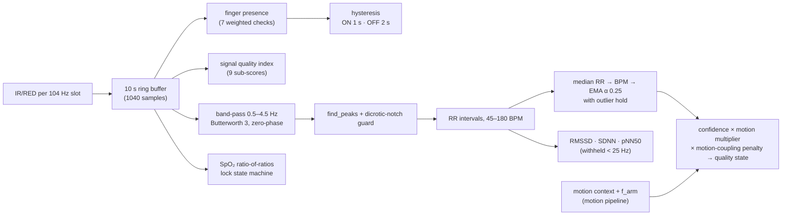

# PPG algorithms (PPG v2.0, pipeline 3.0.0)

Implementation: [`ppg/processor.py`](../../parkinsense/ppg/processor.py) (state, hysteresis,
smoothing, quality) and [`ppg/algorithms.py`](../../parkinsense/ppg/algorithms.py) (stateless DSP).
Tests: [`tests/unit/test_ppg.py`](../../tests/unit/test_ppg.py),
[`tests/synthetic/test_performance_floor.py`](../../tests/synthetic/test_performance_floor.py).
Decision: [ADR-0008](../decisions/0008-ppg-rate-and-quality.md).

> **Validation status.** HR/HRV accuracy figures are from synthetic PPG (two-Gaussian pulse model
> with known beat times). No comparison against ECG or a reference oximeter has been made.
> **SpO₂ is an uncalibrated estimate** and must not be read as a measurement.

## 1. Sampling contract

One IR/RED pair arrives with every IMU sample, so the PPG buffer's sample rate **is the slot
rate, 104 Hz** (`config.PPG_SLOT_RATE_HZ`). The number of *distinct* samples depends on
firmware:

| Firmware | Distinct PPG samples/s | Consequence |
|---|---|---|
| v4 (protocol v1) | 10 (decimated, no anti-alias, zero-order hold) | HR usable; RR quantisation ±100 ms → **HRV withheld** |
| 5.0.0 (protocol v2) | ~100 (newest FIFO sample per slot) | HR and HRV computed |

`PPGProcessor.effective_rate_hz()` measures the distinct-sample rate as
(number of value changes in the IR buffer) / (buffer duration) and publishes it as
`ppg_effective_rate_hz`.

v2.2 constructed `PPGProcessor()` with its default fs = 50 Hz while data arrived at 104 Hz, so
every interval was wrong by 2.08× (HR error 16–18 BPM on synthetic data → 0.3–0.4 BPM now).

## 2. Ingest / analyse split and signal time

`ingest(ir, red)` is called per sample; `analyze(now=t, motion_state=…, motion_frequencies_hz=…)`
once per 0.5 s hop. All timing (hysteresis, EMA outlier hold, SpO₂ publish throttle, SpO₂ lock)
uses `now` = signal time, so replay at any speed gives identical output
(`test_deterministic_with_signal_clock`).

## 3. Finger presence (`assess_finger_presence`)

On the IR buffer (needs ≥ 2 s): DC $=\overline{x}$, AC $=\mathrm{std}(x)$, AC/DC, perfusion
index PI = 100·AC/DC, DC stability from 0.5 s sub-window means
($1-20\cdot\mathrm{std}(\text{sub-means})/DC$, clipped), cardiac frequency content, pulse
repeatability. Seven checks vote with adaptive weights:

| Check | Pass condition |
|---|---|
| DC in range | 5 000 ≤ DC ≤ 0.98 × 262 143 |
| not saturated | max < 0.98 × full scale |
| sufficient AC | AC ≥ 5 counts |
| plausible ratio | 0.0005 ≤ AC/DC ≤ 0.10 |
| stable | stability > 0.3 |
| cardiac frequency | dominant frequency present with cardiac power ratio ≥ 0.15 |
| PI | 0.02 % ≤ PI ≤ 10 % |

`detected` = weighted vote ≥ 0.6 **and** DC in range **and** not saturated **and** cardiac
frequency present. The published `finger_detected` follows the raw verdict only after it has held
for 1.0 s (ON) or 2.0 s (OFF). After 5 s of no finger, the HR EMA and SpO₂ state reset.

## 4. Signal quality index (`compute_signal_quality`)

Band-passed signal $y$; residual $r = (x-\bar x) - y$.
$\mathrm{SNR_{dB}} = 10\log_{10}(\mathrm{var}(y)/\mathrm{var}(r))$.

$$\mathrm{SQI} = 100\,(0.22\,s_{snr} + 0.18\,s_{pc} + 0.10\,s_{clip} + 0.10\,s_{mot} + 0.10\,s_{ent} + 0.10\,s_{conc} + 0.08\,s_{harm} + 0.07\,s_{PI} + 0.05\,s_{rep})$$

| Sub-score | Definition (all clipped to [0, 1]) |
|---|---|
| $s_{snr}$ | SNR_dB / 20 |
| $s_{pc}$ | pulse consistency (beat-interval regularity) |
| $s_{clip}$ | 1 − 5 × clipping fraction |
| $s_{mot}$ | 1 − 10 × fraction of $\lvert\Delta x\rvert$ > median + 10·MAD (`_motion_artifact_score`) |
| $s_{ent}$, $s_{conc}$ | spectral entropy / concentration of the cardiac spectrum |
| $s_{harm}$ | power at 2f₀ and 3f₀ relative to f₀, / 2 |
| $s_{PI}$ | log-scaled perfusion index (0.02 % → 0, 10 % → 1) |
| $s_{rep}$ | pulse repeatability |

`sensor_status`: `SATURATED` (> 1 % samples at rail) · `HIGH_SIGNAL` (DC ≥ 0.85 FS) ·
`LOW_SIGNAL` (DC < 5 000) · `POOR_SIGNAL` (SQI < 40) · `GOOD`; overridden to `NO_FINGER` when the
published finger state is off.

## 5. Heart rate (`estimate_heart_rate`)

A deliberately simple, auditable pipeline (the `develop` README describes an older adaptive
detector that this function no longer uses):

1. Require ≥ 5 s of samples.
2. Band-pass 0.5–4.5 Hz, 3rd-order Butterworth, zero-phase (`filtfilt`).
3. `scipy.signal.find_peaks` with minimum distance $60/(180+20)$ s = 0.30 s and prominence
   ≥ 0.5 × std(filtered).
4. Dicrotic-notch guard: of two peaks within 0.5 s, the one with < 0.6× the other's prominence
   is dropped.
5. RR intervals $r_k = (t_{k+1}-t_k)$; keep 45–180 BPM (0.333–1.333 s); need ≥ 2.
6. $\mathrm{HR} = 60/\mathrm{median}(r)$; rejected if outside 45–180 BPM.

Estimator confidence: $c = 0.45\,\rho + 0.35\,\mathrm{clip}(1-2\,\mathrm{CV}(r)) + 0.20\,\mathrm{SQI}/100$,
$\rho$ = fraction of RR intervals retained.

**Display smoothing** (`PPGProcessor`): EMA $h_t = 0.25\,\mathrm{HR}_t + 0.75\,h_{t-1}$. A jump
> 30 BPM with estimator confidence < 0.5 is held (EMA not updated) for at most 8 s of signal time.

**Overall HR confidence** (`hr_quality.overall_confidence`):

$$C = \mathrm{clip}(0.40\,\tfrac{\mathrm{SQI}}{100} + 0.30\,\text{rhythm} + 0.20\,\text{peak} + 0.10\,s_{mot})
\times m(\text{motion state}) \times \begin{cases}0.25 & \text{motion-coupled}\\1\end{cases}$$

$m$ = 1.0 (REST), 0.8 (LOW MOTION), 0.5 (ACTIVE). In v2.2 this multiplier was never applied
(motion state not passed; dictionary key `LOW_MOTION` vs emitted `LOW MOTION`); it is now keyed by
the shared `MotionState` enum, which accepts both spellings.

### Motion coupling (accelerometer-assisted artefact check)
Rhythmic wrist motion injects a PPG component at the motion frequency, and the beat detector can
lock onto it. With $f_{HR} = \mathrm{HR}/60$ and $f_{arm}$ from the motion pipeline (only passed
when arm RMS ≥ 10 deg/s):

$$\text{motion\_coupled} \iff \exists k\in\{1,2\}:\ |f_{HR} - k f_{arm}| \le 0.12\ \mathrm{Hz}$$

This **detects** and flags the failure (TROIKA, Zhang et al. 2015, instead *removes* the motion
spectrum; not implemented). Synthetic result: under a 1.8 Hz artefact HR error stays ~28 BPM, but
median confidence falls from 0.84 (v2.2, inverted) to 0.17 and the state becomes
`MOTION_ARTIFACT`.

### HR quality state (`hr_quality_state`)
First match wins: `RATE_INVALID` (set by the runtime when the stream rate is invalid) ·
`NO_CONTACT` (no finger) · `INSUFFICIENT_DATA` (no HR) · `MOTION_ARTIFACT` (coupled) ·
`LOW_CONFIDENCE` ($C$ < 0.35) · `VALID`.

## 6. HRV (`compute_hrv_metrics`)

From the RR intervals of the current 10 s buffer, keeping 40–200 BPM; ≥ 4 clean intervals
required:

$$\mathrm{RMSSD}=\sqrt{\tfrac{1}{n-1}\sum (r_{k+1}-r_k)^2},\quad
\mathrm{SDNN}=\mathrm{std}(r,\ \mathrm{ddof}=1),\quad
\mathrm{pNN50}=100\,\tfrac{\#\{|r_{k+1}-r_k|>50\,\mathrm{ms}\}}{n-1}$$

Intervals deviating > 25 % from the median lower `hrv_confidence` but are not removed.
**Withheld** (values `None`, `withheld_reason` set) when the effective PPG rate < 25 Hz.
Caveat: standard HRV norms (Task Force 1996) use 5-minute recordings; 10 s values are for trend
comparison only. Synthetic RMSSD MAE: 6.7 ms (v2 firmware path).

## 7. SpO₂ estimate (`estimate_spo2`)

Ratio of ratios over detected beats: $R = \dfrac{AC_{red}/DC_{red}}{AC_{IR}/DC_{IR}}$ (median of
per-beat values with RED/IR peak-alignment checks), then

$$\mathrm{SpO_2} = 97.601 + 10.503\,R - 11.266\,R^2,\ \text{clipped to } [70, 100]\ \%$$

Lock state machine `SEARCHING → LOCKED → TRACKING → LOST` (confidence ON 0.75 / OFF 0.45, 3 s
of qualifying data to lock), rate limit 1 %/s and 4 % per update, smoothing α 0.15 scaled by
confidence, published every 10 s. v3 changes: lock time and rate limit use **elapsed signal time**
(v2 added the whole 10 s buffer per call — 20× too fast at a 0.5 s hop); state owned by the
processor instance (was a module global never reset).

Limitations: the calibration curve is generic, not fitted to this sensor/finger/LED current;
no reference oximeter data exist. The dashboard labels SpO₂ "UNCALIBRATED ESTIMATE".

## 8. Overall reading confidence (`confidence`)
$\mathrm{clip}(c_{finger}\cdot \mathrm{SQI}/100 \cdot \max(C, 0.3))$ when a finger is detected, else 0.

## 9. Parameters

| Parameter | Value | Where |
|---|---|---|
| buffer | 10 s × 104 Hz | `config.PPG_WINDOW_SECONDS` |
| cardiac band | 0.5–4.5 Hz, order 3 | `algorithms.HR_BAND_*`, `BUTTER_ORDER` |
| HR range | 45–180 BPM | `SIMPLE_HR_*` |
| notch guard | 0.5 s, 0.6 ratio | `SIMPLE_NOTCH_*` |
| EMA α / outlier | 0.25 / 30 BPM, conf < 0.5, ≤ 8 s | `processor.HR_EMA_*` |
| finger hysteresis | 1 s on / 2 s off / 5 s session reset | `processor.FINGER_*`, `SESSION_RESET_SECONDS` |
| motion multipliers | 1.0 / 0.8 / 0.5 | `MOTION_CONFIDENCE_MULTIPLIERS` |
| coupling tolerance / penalty | 0.12 Hz / ×0.25 | `MOTION_COUPLING_*` |
| HRV min rate | 25 Hz | `HRV_MIN_EFFECTIVE_RATE_HZ` |
| publish threshold | 0.35 | `HR_MIN_PUBLISH_CONFIDENCE` |

## 10. Known limitations
* HR during rhythmic movement is often wrong — flagged, not corrected.
* 10 s windows: HRV is short-term only.
* SpO₂ uncalibrated.
* Finger PPG requires the user to hold a finger on the sensor; continuous wear is not possible
  with this sensor placement.
