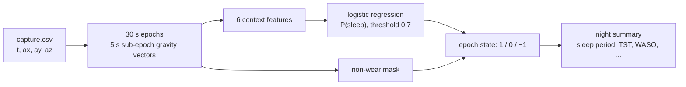

# Sleep: movement-derived sleep/wake estimate (algorithm 1.0)

Code: [`parkinsense/sleep/`](../../parkinsense/sleep/) · Tests: `tests/unit/test_sleep.py`,
`tests/integration/test_sleep_page.py` · Benchmark: `benchmarks/sleep_bench.py` ·
Research: [SLEEP_ALGORITHMS.md](../research/SLEEP_ALGORITHMS.md) · Decision: [ADR-0010](../decisions/0010-sleep-subsystem.md)

**What it is.** An *estimate* of sleep vs wake in 30 s epochs from wrist acceleration only, plus night
summaries. **What it is not.** Not polysomnography, no sleep stages (none are computed, stored or shown),
not clinically validated, not validated on ParkinSense hardware, not validated in Parkinson's disease.
Offline only: it reads a recorded `capture.csv` (or arrays) and never touches the tremor, cardiovascular or
step calculations.



## 1. Epoch features

Samples are binned into 5 s sub-epochs k; ḡₖ is the mean acceleration vector (g). With
zₖ = atan2(ḡₖ,z , √(ḡₖ,x² + ḡₖ,y²)) (arm angle, van Hees 2015):

* Δzₖ = |zₖ − zₖ₋₁|  (deg) — published z-angle change;
* Δgₖ = ∠(ḡₖ, ḡₖ₋₁) = arccos(ḡₖ·ḡₖ₋₁ / (‖ḡₖ‖‖ḡₖ₋₁‖))  — orientation-free variant.

An epoch (6 sub-epochs) keeps dz_max = max Δz, dg_max = max Δg, ENMO = mean max(‖a‖ − 1, 0), and
acc_sd = max over axes of the within-epoch SD. An epoch with < 50 % of the expected samples, or a
sub-epoch with < 25 %, is a **gap**: its features are NaN and its state is −1 (never imputed).

## 2. Context features and classifier

With "moved" = dg_max > 5° and "still" = dg_max ≤ 5°, ± 5 min = ± 10 epochs:

| feature | definition |
|---|---|
| log_dg | log₁₀(dg_max + 0.5) |
| move_density | fraction of moved epochs in the centred window |
| log_enmo_ctx | log₁₀(window mean ENMO + 10⁻³) |
| still_bout | 1 if the epoch is inside a run of still epochs ≥ 5 min (the van Hees rule as one feature) |
| log_since_move, log_until_move | log(1 + min since / until the nearest moved epoch), capped at 60 min |

P(sleep) = σ(b + wᵀx), fitted by Newton / IRLS with L2 penalty λ = 1 on standardised inputs (bias unpenalised);
epoch = sleep if P ≥ θ. θ = 0.7 was chosen by an inner leave-one-subject-out loop on the Walch training
subjects. The weights are in `parkinsense/sleep/params.py` (generated by
`benchmarks/sleep_bench.py --emit-params`, fitted on all 17 scored Walch subjects: **in-sample for those
subjects**; out-of-sample performance is the leave-one-subject-out table in the validation report).

A tempered 2-state HMM and two heart-rate features exist in the code for experiments. They lowered held-out
agreement and are disabled (`smooth: False`, accelerometer only).

## 3. Night summary (`night.summarize`)

* **Non-wear:** runs ≥ 60 min with acc_sd < 13 mg → state −1 (a perfectly flat signal is a sensor on a table, not sleep).
* **Sleep period (SPT):** sleep runs merged when separated by < 60 min (HDCZA-style); longest block, must be ≥ 30 min.
  No qualifying block, or < 2 h analysable data → `INSUFFICIENT_DATA` and **no numbers**.
* **TST** = sleep epochs in SPT; **WASO** = wake epochs in SPT; `gap_in_spt` reported separately.
* **period_efficiency** = TST / (TST + WASO). *Not* the clinical sleep efficiency (no time-in-bed is known).
* **awakenings** = wake runs ≥ 2 epochs (1 min) in SPT; **fragmentation** = awakenings per hour of TST.
* **movement_in_sleep** = share of sleep epochs with dg_max > 5°.
* Quality: `VALID` if SPT and total coverage ≥ 80 %, else `DATA_GAP`. Every summary carries `estimate: true`.

Versions recorded with every output: `sleep_algorithm_version` (1.0), `sleep_epoch_schema_version` (1),
`pipeline_version`. Sleep versions are separate from tremor, step, firmware, capture-schema and protocol versions.

## 4. Public API

```python
from parkinsense.sleep.api import analyze, analyze_file
report = analyze_file("recordings/<session>/capture.csv")   # or analyze(t_seconds, acc_g)
report["night"]["tst_min"], report["epochs"]["state"]        # 1 sleep, 0 wake, -1 no data
```

CLI: `parkinsense-sleep capture.csv --json report.json`.

## 5. Measured performance (public data, not ParkinSense)

Leave-one-subject-out on Walch 2019 (Apple Watch, 17 subjects). Full tables, confidence intervals and the
ablations are in [../validation/SLEEP_STEP_VALIDATION.md](../validation/SLEEP_STEP_VALIDATION.md).

## 6. Known limits

* Quiet wakefulness is classed as sleep (wake specificity ≈ 0.58 vs PSG here).
* Walch is healthy adults, one night each, sleep prevalence 90 %; 17 subjects is small; single PSG scorer.
* Not validated on ParkinSense hardware, where the sensor sits on the wrist/finger assembly, the IMU range and
  noise differ, and the wearable's overnight behaviour (comfort, finger contact, battery) is unknown.
* Medication, dyskinesia, nocturnal tremor or restlessness in Parkinson's disease may change movement–sleep
  relations; no evidence either way is claimed.
