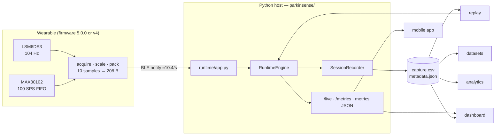
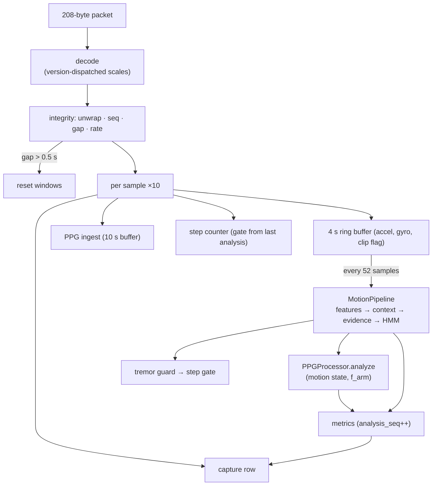

# Architecture

## 1. System overview

ParkinSense has four layers. Each has one responsibility and a versioned interface to the next.

| Layer | Where | Responsibility | Interface out |
|---|---|---|---|
| Sensing | XIAO nRF52840 Sense, LSM6DS3, MAX30102 | acquire IMU at 104 Hz and PPG | — |
| Firmware | `firmware/` | timestamp, scale, pack 10 samples, flag faults, transmit | BLE protocol v1/v2 ([spec](../protocol/BLE_PROTOCOL.md)) |
| Processing | `parkinsense/` | decode, integrity, motion/tremor, PPG, steps, quality | capture CSV v3, `metadata.json`, metrics JSON / HTTP |
| Consumers | dashboard, replay, datasets, analytics, mobile app (separate repo) | display, re-analyse, aggregate | — |



## 2. Processing pipeline inside `RuntimeEngine`



Details: [runtime](../runtime/RUNTIME_AND_RECORDING.md), [tremor](../algorithms/MOTION_AND_TREMOR.md),
[PPG](../algorithms/PPG.md), [steps](../algorithms/ACTIVITY.md).

## 3. Cross-pipeline information flow

| From | To | What | Why |
|---|---|---|---|
| motion context | PPG | motion state → confidence multiplier 1.0 / 0.8 / 0.5 | motion corrupts PPG |
| motion features | PPG | dominant arm-movement frequency | detect HR locked onto motion |
| motion context | step counter | moving gate (REST never counts) | tremor/handling ≠ steps |
| tremor HMM | step counter | gate forced to REST during confirmed rest tremor | tremor oscillation ≠ steps |
| stream integrity | tremor, PPG | rate INVALID → tremor `DATA_GAP`, HR `RATE_INVALID` | frequencies scale with rate error |

## 4. Time model

Three clocks are recorded (device, host monotonic, host wall); only **signal time** derived from
device timestamps drives processing. This is what makes live and replay identical
([ADR-0006](../decisions/0006-runtime-engine.md)).

## 5. Module map

| Package | Owns | Must not |
|---|---|---|
| `protocol` | wire format, version dispatch, unwrap, sequence/gap tracking | know about physiology |
| `motion` | spectra, features, context, the per-window motion pipeline | hold PPG state |
| `tremor` | per-window evidence, HMM | compute features |
| `ppg` | buffers, hysteresis, smoothing, quality; stateless DSP in `algorithms` | read clocks other than `now` |
| `activity` | per-sample step detection | compute motion context |
| `runtime` | orchestration (`engine`), files (`recorder`), BLE/HTTP (`app`) | mix these three |
| `replay`, `datasets`, `analytics` | offline use of recordings | re-implement processing |
| `synthetic` | ground-truth generators | be imported by runtime code |
| `visualization` | display | import processing modules |

Full API: [Python package reference](../software/PYTHON_PACKAGES.md).

## 6. Repository layout

```text
parkinsense/            Python package (see module map)
benchmarks/             baseline-vs-current harness, committed results
tests/                  unit · integration · regression · synthetic · hardware
firmware/
  parkinsense_wearable/ firmware 5.0.0 (protocol v2)
  legacy/               ble_stream_v4 (protocol v1, hardware-verified) and older sketches
  tests/                host tests + API stubs
data/reference/         real recordings for regression (BLE v1 at 104 Hz; serial logs at ~23 Hz)
docs/                   this documentation (index: docs/README.md)
.github/workflows/      CI
pyproject.toml          package metadata, extras, entry points, pytest config
requirements.txt        flat dependency list
```

## 7. Design principles

1. **Measure, don't assume** — sample rate, loss, wraps and clipping are measured and recorded.
2. **Determinism** — signal time everywhere; replay is the regression tool.
3. **Quality is part of the value** — every biomarker carries a state.
4. **Provenance** — every row and session names the versions that produced it.
5. **Compatibility by addition** — wire, schema and API evolve by versioned addition.
6. **Evidence before replacement** — an algorithm changes only with a measured improvement.

## 8. Historical documents

[`research/SRS_v1_historical.md`](../research/SRS_v1_historical.md) (original requirements draft) and
the two audits in [`audit/`](../audit/) describe the system before pipeline 3.0.0.
