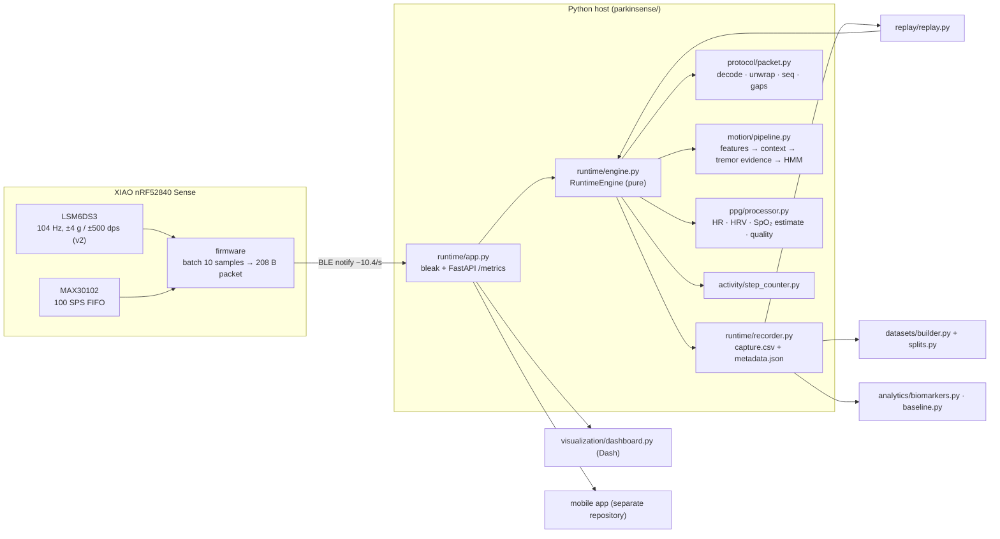

# Architecture

## Two clocks (ADR-0001)

Per sample (104 Hz): decode, PPG buffer ingest, step counter, capture row.
Per hop (every 52 samples = 0.5 s, once the 4 s window is full): motion/tremor analysis and PPG
analysis. The capture marks the row where analysis ran (`is_analysis_row`, `analysis_seq`).

## Time

All temporal logic (tremor HMM, PPG hysteresis/throttling/SpO₂ lock, step timing) runs on
**signal time** = unwrapped device timestamp. Host wall clock and `time.monotonic()` are recorded
for provenance only. Consequence: live processing and replay at any speed are identical
(`tests/integration/test_replay_and_recording.py::test_live_and_replay_are_identical`).

## Module responsibilities

| Module | Owns | Does not |
|---|---|---|
| `protocol/packet.py` | wire format, version dispatch, unwrap, sequence/gap tracking | physics |
| `motion/features.py` | Welch PSD per axis, interpolated tremor peak, band powers | decisions |
| `motion/context.py` | REST / LOW MOTION / ACTIVE from non-tremor-band movement | tremor |
| `tremor/detector.py` | per-window evidence in [0, 1] | temporal logic |
| `tremor/temporal.py` | HMM posterior, hysteresis, legacy state names | features |
| `ppg/processor.py` | buffers, hysteresis, EMA, SpO₂ lock state, quality state | DSP math (`ppg/algorithms.py`) |
| `activity/step_counter.py` | per-sample step detection | motion context |
| `runtime/engine.py` | orchestration, integrity, schema | I/O |
| `runtime/recorder.py` | files, provenance | processing |
| `runtime/app.py` | BLE, API, lifecycle, reconnect | processing |

## Capture schema v3

52 legacy columns in their original order, then 27 appended columns (`session_id`,
`host_monotonic`, `device_time_us`, `packet_seq`, `packets_lost`, `gap_before_s`,
`possibly_clipped`, `is_analysis_row`, `analysis_seq`, tremor v3 fields, quality states,
`device_rate_hz`, `rate_status`, configuration and version columns). See
`parkinsense/runtime/engine.py::CAPTURE_COLUMNS`. Column time bases: ADR-0003.
