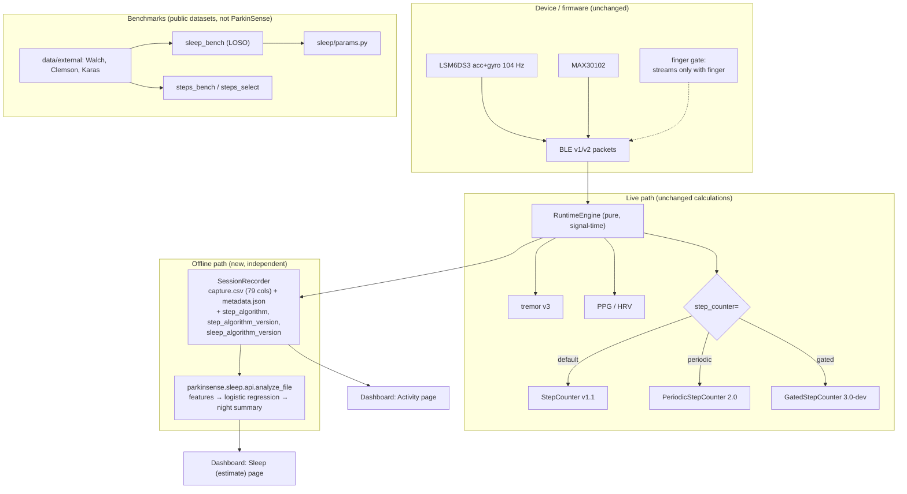

# Sleep and step subsystems — architecture

Boundaries that matter:

* `parkinsense/sleep/` imports nothing from `motion/` or `ppg/`; its only other dependency is `replay.load` (lazily, to parse
  capture formats). Nothing outside the dashboard imports `sleep/`. Sleep reads a recording after the fact, so it cannot change a
  tremor or cardiovascular value.
* Only the step *selector* touched the runtime: `RuntimeEngine(step_counter=...)` and three metadata keys. The default
  path, the 79-column capture schema and every pre-existing test are unchanged.
* Versions are independent: sleep algorithm / epoch schema, step algorithm, pipeline, firmware, capture schema, protocol.
