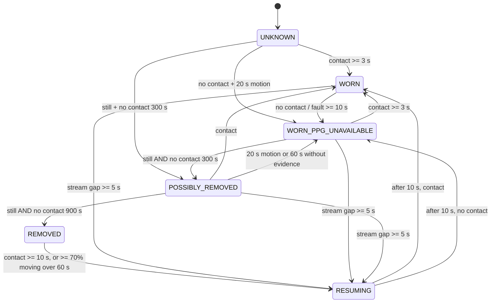

# Wear-aware acquisition (Phase 8)

Goal (programme): continuous, quality-aware monitoring while worn, including overnight, and low power when removed —
without treating PPG finger detection as proof of wear and without running everything at full rate regardless.

**Verification classes used below** — *Implemented* (code exists) · *Automated-test verified* (pytest/g++ in CI) ·
*Host-simulated* (synthetic or public-data signals) · *Hardware-tested* · *Externally validated* · *Clinically validated*.
In this phase: the host monitor is implemented, automated-test verified and host-simulated. **Nothing is
hardware-tested, externally validated or clinically validated.** Firmware 5.0.0 itself has never been compiled for the
nRF52840 core, flashed or measured.

## 1. What `REQUIRE_FINGER_FOR_STREAMING` gates (read from `parkinsense_wearable.ino`, `config.h`)

| Stage | Gate = true (shipped default) | Gate = false |
|---|---|---|
| Boot state | `systemActive = false` | `systemActive = true` |
| MAX30102 polling / FIFO drain | **always** (idle loop drains it, 10 ms delay) | always (every 104 Hz tick) |
| Finger state machine (`updateFingerGate`) | runs every 250 ms: IR > 50 000 for 3 polls → stream; ≤ 50 000 for 3 polls → stop | returns immediately; never runs |
| IMU reads (`readRegisterRegion`) | **only while active** | always |
| Packet construction, `seq`, timestamps | only while active (partial batch is discarded when the finger leaves) | always |
| BLE `notify()` | only while active and connected | whenever connected |
| BLE advertising / connection | **always** (restarts on disconnect) | always |
| PPG content of packets | `ir`/`red` from the same FIFO | same |

Consequences:

1. With the gate on, **no IMU, tremor, step or sleep data exists without optical contact** and the host cannot tell
   "device removed" from "finger lifted" from "out of BLE range": all look like silence. Overnight monitoring is
   impossible unless a finger rests on the sensor all night.
2. With the gate off, IMU and PPG are independent: the IR counts still travel in every sample, so the host can derive
   contact itself (`ir` ≥ threshold) and **no protocol change is needed** for independent IMU/PPG operation.
3. The gate also acts, accidentally, as a crude power gate: when idle the IMU is not read and BLE is silent. Turning it
   off without a replacement raises the active duty cycle. **Neither state has a current measurement.**
4. No downlink exists: the only characteristics are the notify characteristic and the Device Information Service.
   The host cannot command the device (no write characteristic), so wear-driven power changes must be decided on the
   device.

## 2. Hardware verdict: can the current hardware detect wear reliably?

Evidence read: `docs/hardware/HARDWARE.md`, firmware, protocol, the two prototype photographs.

| Question | Finding |
|---|---|
| How is the MAX30102 mounted? | Documentation calls it a **finger sensor**. The photographs show two breakout boards in a 3D-printed case on an elastic hook-and-loop strap on the top of the wrist. They do not show which way the optical window faces or any contact pad. (The open-case photo also appears to show an ESP32-S3-labelled XIAO board while the documentation says nRF52840 Sense; treat the BOM as **unverified until the board is read off**.) |
| Finger or wrist sensor? | Configured and thresholded as a finger sensor (IR > 50 000; v4 recorded ≈ 1 600 without and ≈ 109 000 with a finger; LED current 0x1F). Whether the same sensor on the wrist exceeds 50 000 is **unmeasured**; red + IR only, no green channel. Wrist PPG quality must not be assumed from finger behaviour (test W6). |
| Does PPG contact work in the intended wearing configuration? | Unknown. It is a *finger* contact signal; a wrist-worn device with the finger off the sensor reads "no contact" for hours of correct wear. |
| Any dedicated skin-contact, proximity or temperature sensor? | **None.** Bill of materials: LSM6DS3, MAX30102, battery, USB-C board. The MAX30102 breakout exposes an INT pad, but the firmware states **no INT pin is wired**; wiring is undocumented (`hardware/` was empty). |
| Can the LSM6DS3 alone classify wear? | **No, not reliably.** See §3: worn sleeping wrists are as still as a table at the noise floor of a public wrist accelerometer. |
| Unused interfaces on the existing board? | The XIAO board exposes spare GPIO/analog pins (a capacitive pad is feasible without a new IC) but the project has no schematic/PCB; spare interfaces cannot be confirmed from the repository. |

**Verdict: the current hardware cannot reliably distinguish "worn but PPG unavailable" from "removed and lying still".**
The host monitor can only *infer* REMOVED, and labels it inferred. Any power-saving REMOVED mode on the device
needs an independent skin-contact signal.

### Minimum additional sensing (options, not a selection)

Figures are order-of-magnitude, from general knowledge of these part classes, **not datasheet-verified in this phase**;
check datasheets before choosing. Hardware change itself needs a PCB/enclosure decision that belongs to Phase 12.

| Option | Extra BOM | Extra current (order of magnitude) | Integration | Reliability implications | View |
|---|---|---|---|---|---|
| Capacitive back-plate pad read with spare GPIOs (charge-time method) | ≈ 0 (copper pad/ electrode in enclosure) | µA when duty-cycled | Firmware + enclosure geometry; no new bus | Sensitive to humidity, sweat, strap pressure; needs per-unit baseline; works with a still wrist (no motion needed) | **First prototype candidate**: cheapest, answers exactly "skin present" |
| Dedicated capacitive-touch IC | low (≈ $0.5–1) | ≈ µA | One GPIO | Same physics, better-conditioned | Fallback if GPIO method is noisy |
| I²C optical proximity/ambient sensor facing skin | ≈ $1–3 | tens of µA duty-cycled (IR LED pulses) | I²C, window in the case | Confused by ambient IR and gaps under the strap; distinguishes "close object" not "skin" | Fallback; fusion partner |
| Skin-temperature sensor | ≈ $1–3 | µA | I²C, needs thermal path to skin | Slow (tens of seconds), ambient-dependent; supports, cannot decide alone | **Evidence only**, not a primary sensor |
| Optical contact from the existing MAX30102 | 0 | 0 | none | Finger-contact semantics; unknown wrist behaviour; the reason this document exists | Already used as one input, never sole evidence |
| Fusion (optical + capacitive + motion) | sum | sum | monitor already accepts independent evidence | Best robustness; needs the data to set weights | Target architecture |

Nothing was selected or ordered. The decision needs W1–W6 data (`docs/validation/PHASE_8_VALIDATION_PLAN.md`).

## 3. Why motion alone cannot decide removal (public-data evidence, not hardware)

`benchmarks/wear_bench.py` on 15 usable Walch PSG nights (Apple Watch, 50 Hz; the whole night is worn by construction):

* Pooled epoch (1 s) max-axis SD: 1st/5th/25th/50th percentile = 0.89 / 1.06 / 1.39 / 1.83 mg — the worn, sleeping wrist
  sits close to the sensor's noise floor.
* Mean share of a worn night inside still runs ≥ 15 min: **0 %** at 1 mg, 3.3 % at 2 mg, 13.2 % at 4 mg, 27.9 % at
  8 mg, **36.2 % at 13 mg** (the GGIR/van Hees non-wear SD). 15/15 subjects have such runs at 13 mg.
* The Phase 8 state machine with PPG forced **absent** (worst case): mean time REMOVED 0 % / 6.7 % / 42.5 % at
  1 / 2 / 4 mg; subjects ever REMOVED 0 / 5 / 12 of 15; one subject 31.6 % at 2 mg.
* 27 Karas subjects, 623 min of labelled driving (seated, hands on wheel), shipped defaults: 0 % REMOVED.

So thresholds loose enough to catch a table also condemn sleepers. The shipped default (1 mg) is the **fail-safe
choice**: no false removal in these data. It was chosen on those same data, and the Apple Watch noise floor is about
the same value, so on that sensor 1 mg would almost never flag a table either. **Sensitivity to true removal is
unmeasured** — no public wrist dataset has non-wear ground truth. LSM6DS3 bench noise is also unmeasured (W1).

## 4. State model

Five independent concepts (separate enums in `parkinsense/wear/monitor.py`):

| Concept | Values | Source |
|---|---|---|
| Wear state | UNKNOWN, WORN, WORN_PPG_UNAVAILABLE, POSSIBLY_REMOVED, REMOVED, RESUMING | state machine (inferred) |
| IMU state | NO_DATA, STREAMING, FAULT | epoch completeness and `IMU_FAULT` flag |
| PPG state | UNKNOWN, CONTACT, NO_CONTACT, FAULT | IR level vs `contact_ir_min`, debounced; `PPG_FAULT` flag |
| Link state | NO_DATA, STREAMING, GAP | sample-time gaps |
| Power state | UNKNOWN | **always**: protocol v1/v2 carries no battery or power data |

`UNKNOWN` is an addition to the five programme states: the state before any evidence; downstream behaviour is identical
to WORN (nothing is suppressed).

### Evidence rules (enforced by tests)

* Stillness alone is never removal (a still sleeper with optical contact stays WORN for an hour in test).
* PPG contact loss alone is never removal (moving wrist, finger off: WORN_PPG_UNAVAILABLE for an hour).
* PPG **FAULT** ≠ no contact: counts as no evidence either way.
* IMU **FAULT** zeros look perfectly still: faulted epochs are excluded from stillness.
* Removal needs **both** continuous NO_CONTACT **and** continuous stillness, for 300 s (POSSIBLY_REMOVED) and 900 s
  (REMOVED); any non-still epoch restarts the clock. Stream gaps restart it too, so a gap never creates a removal.
* A gap from REMOVED stays REMOVED. Table bumps (3 s) do not re-wear; 60 s of mostly-moving samples does.
* Re-wear by motion lands in WORN_PPG_UNAVAILABLE (evidence `MOTION_ASSUMED_WORN`), never WORN: motion cannot
  prove a finger is on the sensor, and a device carried in a hand or bag looks the same. Documented limitation.
* Chatter: contact flickering 4 s on / 4 s off for 8 min produces ≤ 6 transitions (test).

### Output semantics (`WearStatus`)

`activity_allowed` and `tremor_allowed` are false only in REMOVED; `physiology_allowed` (HR/HRV/SpO₂) only in a settled
WORN with contact; `inferred` is always true on current hardware. The engine **does not drop data** in any state.

### Thresholds (`WearConfig`, all configurable; provisional)

`still_acc_sd_g` 0.001, `still_gyro_dps` 0.5, `still_angle_deg` 2, `contact_ir_min` 50 000 (the firmware's own
threshold), `contact_on_s` 3, `contact_off_s` 10, `possibly_removed_s` 300, `removed_s` 900, `motion_return_s` 20,
`evidence_lapse_s` 60, `rewear_contact_s` 10, `rewear_motion_s` 60 (≥ 70 % moving), `gap_s` 5, `resume_s` 10. Only
`still_acc_sd_g` has been evaluated, and only for the false-removal side on public data. The durations are design
choices pending W2/W3. `WearConfig` rejects inconsistent hysteresis (e.g. `removed_s ≤ possibly_removed_s`).

## 5. Implementation (what exists)

| Piece | Location | Notes |
|---|---|---|
| Monitor | `parkinsense/wear/monitor.py` | pure, signal-time, any sample rate; 3.1 µs/sample measured (Python, 1 h of 104 Hz in 10-sample blocks, aarch64 sandbox; **not** a Cortex-M cost) |
| Runtime hook | `RuntimeEngine(wear_monitor=True \| WearConfig)` | **opt-in, off by default** (default behaviour and golden replay unchanged). When on: REMOVED forces the step gate to REST so table movement is not counted as steps; `metadata.json` gains a `wear` block (state, time in state, transitions, config) |
| Offline analysis | `parkinsense-wear capture.csv [--set key=value]`, `parkinsense.wear.api` | reads v3/v2/v1 captures including the `flags` column; matches the live monitor (test) |
| Evaluation | `benchmarks/wear_bench.py` → `benchmarks/results/wear_public_data.json` | public-data false-removal evidence |
| Tests | `tests/unit/test_wear.py` (22) | evidence rules, hysteresis, gaps, faults, re-wear, config, engine integration for protocol v1 and v2, recorder metadata, capture round-trip |

Not implemented: any firmware change, any protocol change, any capture column, dashboard display, mobile display.

## 6. Firmware and protocol decision (ADR-0014)

**No firmware or protocol change in Phase 8.** Reasons:

1. Independent IMU/PPG operation is already available through the existing compile-time profile
   `REQUIRE_FINGER_FOR_STREAMING = false`; IR travels in every sample, so contact is derivable on the host.
2. Defining bit 7 (`0x80`, reserved) or a new field would repurpose reserved space or require protocol v3 with
   firmware packing tests, Python decode tests and v1/v2 compatibility tests — justified only when the **device**
   computes a wear state, which needs the extra sensor of §2.
3. Any firmware edit would be unverifiable here: 5.0.0 is not yet flashed and no board is reachable.

Build profiles (research acquisition quality is identical in both):

| Profile | Setting | Use |
|---|---|---|
| A — finger-gated (shipped default) | `REQUIRE_FINGER_FOR_STREAMING = true` | PPG-centred sessions; saves radio and IMU time when idle (unmeasured) |
| B — continuous | `= false` | Overnight and tremor-only recording; host `wear_monitor=True` labels worn/removed periods |

Profile B has **not** been flashed or run; it is the smallest safe firmware modification (a one-line constant), and the
code path it enables (`systemActive` true from boot, gate function inert) was read and compiles in the host type-check
that CI runs. Before it is used for overnight data: H1–H3, H5 and the W/P tests.

Future, when a skin-contact sensor exists: add the sensor read to the sampling loop, run the same state machine
(thresholds from W data) in firmware, and publish it via protocol **v3** (new `version` value, new decoder branch,
v1/v2 decoders retained, packing tests and cross-language golden bytes), never via the reserved flag bit.

## 7. Power-management design (proposal; no current has been measured)

Levers to evaluate with the PPK2 procedure in [POWER_MEASUREMENT](../hardware/POWER_MEASUREMENT.md):

| Lever | Current state in 5.0.0 | Candidate | Risk |
|---|---|---|---|
| IMU ODR | 104 Hz, always while active | Lower ODR in REMOVED; research mode stays 104 Hz | Re-wear latency; stillness statistics change with ODR |
| IMU mode | Normal power | Hardware wake-on-motion / activity detection in REMOVED (LSM6DS3 feature, to confirm in datasheet) | Table bumps wake it |
| PPG | Running always (LEDs at 0x1F, 100 SPS) | Shut down/duty-cycle when NO_CONTACT for long; periodic contact probe | Slower PPG reacquisition |
| BLE connection interval | 7.5–15 ms requested | Longer interval in REMOVED | Reconnection and notify behaviour change |
| Batch size | 10 samples (208 B) | Larger batches need protocol change | Latency; framing is fixed by v1/v2 |
| Advertising | Continuous (`start(0)`) | Slower interval when removed | Slower reconnection |
| Idle loop | 10 ms RTOS delay | Longer sleep | PPG drain must stay inside FIFO depth (32 samples at 100 SPS ≈ 320 ms) |
| Watchdog | none | hardware watchdog (InfiniTime pattern) | A hang in low power must not lose a night |

REMOVED mode (design): PPG LEDs off, IMU at wake-on-motion, BLE advertising at a long interval, a periodic contact
probe, re-wear = contact or sustained motion → RESUMING (timestamps continue from `micros()`; `seq` keeps counting so
the host sees exactly how many packets were skipped, as in a normal gap). **Needs the device to know it is removed →
needs the §2 sensor.** Until then there is no honest on-device low-power REMOVED mode.

## 8. Known limitations

* REMOVED is inferred; with the shipped threshold it will rarely trigger, by design.
* No removal sensitivity measurement exists. No hardware wear data exists.
* Motion-based re-wear cannot tell wear from carrying.
* Epoch statistics assume ≥ 20 Hz data and accelerometer noise comparable to or above 1 mg.
* The step counter's own gate still decides what is a step; the monitor only removes steps in REMOVED.
* Power state is permanently UNKNOWN on the host.
