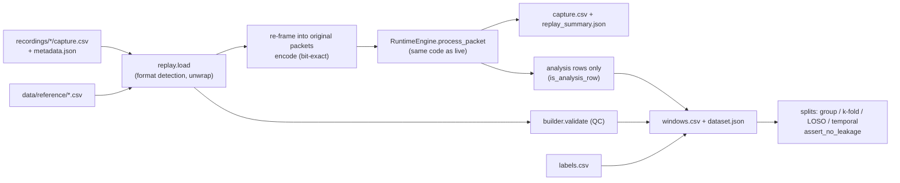

# Replay, datasets and research methodology

Implementation: [`replay/replay.py`](../../parkinsense/replay/replay.py),
[`datasets/builder.py`](../../parkinsense/datasets/builder.py),
[`datasets/splits.py`](../../parkinsense/datasets/splits.py).
Tests: [`tests/integration/test_replay_and_recording.py`](../../tests/integration/test_replay_and_recording.py),
[`tests/unit/test_activity_and_splits.py`](../../tests/unit/test_activity_and_splits.py),
[`tests/regression/`](../../tests/regression/).



## 1. Replay

### Supported inputs (auto-detected)

| Kind | Recognised by | Time column | Packet framing |
|---|---|---|---|
| `capture_v3` | `device_time_us` column | `device_time_us` | grouped by `packet_count` |
| `capture_v2` | `sample_timestamp_us` | 32-bit, unwrapped by `replay._unwrap32` | grouped by `packet_count` |
| `ble_v1_raw` | `timestamp, ax..gz, ir, red` | `timestamp` (µs) | consecutive groups of 10 |
| `legacy_serial` | `timestamp, ax..gz` only (~23 Hz, ms) | — | refused unless `--resample` |
| `legacy_serial_resampled` | with `--resample` | linear interpolation to 104 Hz | groups of 10, encoded as v2 (so ±512 dps fits); PPG = constant no-finger values |

Resampled legacy logs contain no information above their original Nyquist (~11 Hz); they are
useful only for motion-context, step and low-frequency checks, and for the golden regression.

### Fidelity

Rows are re-framed into the original packets and re-encoded with the recorded `packet_version`.
`encode` rounds to the nearest count, so the engine receives the original integers
(`test_roundtrip_exact`). Partial trailing packets are dropped. Packets are fed through
`RuntimeEngine.process_packet` — the live code path — with `host_monotonic` set to device time.

### Determinism

All temporal logic uses signal time, so output is independent of replay speed and identical to
the live session from the point the recording starts (`test_live_and_replay_are_identical`,
`test_replay_is_deterministic`). `--realtime --speed X` only paces delivery for observation.

### Commands

```bash
parkinsense-replay recordings/<session>/capture.csv --out replays/run_a
parkinsense-replay data/reference/legacy_serial_23hz/walking_60s.csv --resample
parkinsense-replay x --compare replays/run_a replays/run_b
```

`--compare` aligns two outputs on `device_time_us` analysis rows and reports
`classification_agreement` and max absolute differences of frequency, heart rate and tremor
probability — the tool for comparing pipeline versions on the same recording.

`replay_summary.json` records `source` (path, SHA-256, rows, kind, source pipeline/firmware
versions if present), `replay_pipeline_version`, `capture_schema_version`, measured rate,
integrity counters and an `outputs` summary (tremor fraction, rest-tremor fraction, median tremor
frequency, motion-state fractions, final steps, valid-HR fraction, median valid HR).

### Never reinterpret silently

A historical recording keeps its original columns; replay writes a *new* file stamped with the
replay pipeline version. To compare data recorded under 2.x with 3.x outputs, replay both through
the same version.

## 2. Dataset builder

```bash
parkinsense-dataset recordings/*/capture.csv --out datasets/v1 --version 1.0.0 \
    --labels labels.csv --subjects subjects.json
```

Stages: ingest (`replay.load`) → QC (`validate`) → reprocess through the current engine →
keep **one row per analysis window** → assign labels → write `windows.csv` and `dataset.json`.

### Quality checks (`validate`)

| Check | Reject when |
|---|---|
| timestamps | any backward step |
| missing samples (from gaps > 1.5 periods) | > 5 % |
| rate | > 5 % from 104 Hz |
| v1 gyro at ±249 dps or more | > 1 % of samples (possible on-device wrap) |
| packet versions | more than one in a recording |

Duplicates and gap counts are recorded but not rejection criteria. `--include-rejected` keeps
rejected recordings (their QC is still written).

### Window rows

`recording_id`, `subject_id`, the window-level features (`analysis_seq`, `device_time_us`,
tremor/HR/step fields listed in `builder.WINDOW_FEATURES`), `window_start_s`, `window_end_s`
(relative to the first analysis), `source_sha256`, `pipeline_version`, `label`.
Consecutive windows overlap 87.5 % — they are **not** independent samples.

### Labels

`labels.csv`: `recording_id,start_s,end_s,label[,subject_id]`, times in seconds of window time.
A window gets the label when ≥ 50 % of it lies inside the interval (`min_overlap`).
`subjects.json`: `{"<recording_id>": "<subject_id>"}`; without it each recording is its own
subject.

### dataset.json

`dataset_version`, `pipeline_version`, `capture_schema_version`, `unit` (window definition),
per-recording QC, `windows`, `label_counts`, `split_policy`, `synthetic: false`.

## 3. Splitting without leakage

```python
import pandas as pd
from parkinsense.datasets import splits

df = pd.read_csv("datasets/v1/windows.csv")
train, test = splits.group_split(df, test_fraction=0.25, by="subject_id", seed=0)
splits.assert_no_leakage(train, test)                     # raises if a subject or source file is shared

for k, (tr, te) in enumerate(splits.group_kfold(df, k=5)):
    ...
for subject, tr, te in splits.leave_one_group_out(df):    # LOSO, as used to validate ParaDigMa
    ...
tr, te = splits.temporal_split(one_recording_df, test_fraction=0.25)   # guard gap ≥ one window
```

Rules:

1. Never split windows at random.
2. Split by subject when the claim is about new people; by recording/session when it is about
   new sessions of known people.
3. Use `temporal_split` only within one recording; it leaves a gap of at least one window
   between train and test so no window straddles the boundary.
4. Tune thresholds on training groups only; report test metrics once.

## 4. Provenance and versioning

| What changed | Bump |
|---|---|
| definition or temporal behaviour of any published value | `PIPELINE_VERSION` + ADR |
| tremor / step / PPG algorithm internals | matching `*_VERSION` |
| capture columns | `CAPTURE_SCHEMA_VERSION` (append-only) |
| wire format | protocol `version` byte + new decoder branch |

Every capture row and `metadata.json` carries these versions; every dataset carries source hashes.

## 5. Research methodology checklist

* State whether results are synthetic, real-unlabelled, real-labelled or reference-device data.
* Report per-subject results and their spread, not only pooled numbers.
* Report the number of subjects and the total valid observation time.
* Keep the label protocol (who labelled, from what video/reference) with the dataset.
* Never claim clinical accuracy from synthetic or single-subject data.
