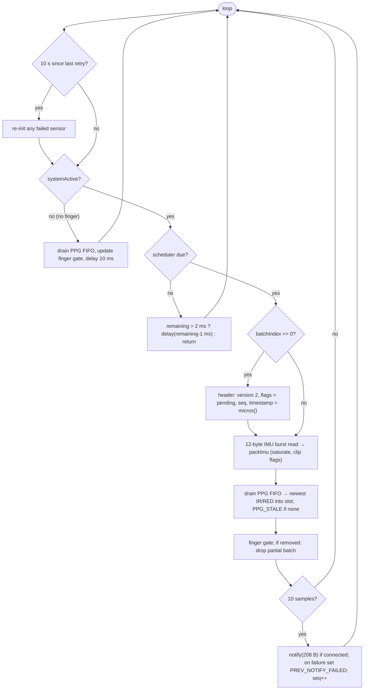

# Firmware

| Build | Path | Protocol | Status |
|---|---|---|---|
| **parkinsense_wearable 5.0.0** | `firmware/parkinsense_wearable/` | v2 | written, host-tested, type-checked; **not compiled with the nRF52 core, not flashed, not measured** |
| ble_stream_v4 | `firmware/legacy/ble_stream_v4/` | v1 | last hardware-verified build; use it for data collection until v5 passes H0–H6 |
| older sketches | `firmware/legacy/*` | v1 / none | historical (v1 stream, v3, IMU-only, OLED, dataset recorder, modular v3) |

The firmware only acquires, timestamps, packs and transmits. All signal processing runs on the
host, so algorithms can change without reflashing.

## v5 source layout

| File | Responsibility |
|---|---|
| `parkinsense_wearable.ino` | setup, sensor init/retry, finger gate, sampling loop, BLE notify |
| `config.h` | every build-time constant (rates, ranges, thresholds, BLE intervals, version string) |
| `packet.h` | wire structs, flags, saturating conversion, burst-to-wire packing, scheduler — **no Arduino dependency**, unit-tested on the host |

## Main loop (v5)



### Timing

`ps::Scheduler` keeps a fixed 9 615 µs cadence (104.0 Hz). Each call that finds the next
deadline passed produces one sample and advances the deadline by one interval, so short stalls
are caught up sample by sample. If more than `MAX_CATCHUP_INTERVALS` (5) intervals have
elapsed, it snaps forward to *now* and sets `TIME_DISCONTINUITY` in the next packet header,
telling the host that nominal per-sample times are approximate. Wrap of the 32-bit `micros()`
counter is handled with signed differences (tested).

The packet timestamp is `micros()` when the first sample of the batch is taken; the host
reconstructs sample *i* as `timestamp + i × 9615 µs`.

### IMU acquisition and scaling

Settings are written before `imu.begin()` (v4 wrote them after, so they never reached the
sensor). One `readRegisterRegion(raw, OUTX_L_G, 12)` returns gx, gy, gz, ax, ay, az as
little-endian int16. `ps::packImu` converts with datasheet sensitivities and re-scales to wire
counts:

$$a_{wire} = \mathrm{round}(a_{raw}\cdot 0.122\times10^{-3}\cdot 8192),\qquad
g_{wire} = \mathrm{round}(g_{raw}\cdot 17.5\times10^{-3}\cdot 64)$$

Values beyond int16 saturate (never wrap). `ACCEL_CLIPPED` / `GYRO_CLIPPED` is set if a wire
value saturated **or** the sensor's own reading sat at its rail (±32 767/−32 768).

### PPG acquisition
The MAX30102 runs at 100 SPS into its FIFO. v5 drains the FIFO on every 104 Hz tick and places
the newest IR/RED pair in the slot; since the sensor is slightly slower than the slot rate,
roughly 4 % of slots repeat the previous value and set `PPG_STALE`. v4 drained every 100 ms
and kept only the last sample (10 Hz, no anti-alias filter).

### BLE
* Name `ParkinSense`; custom service `ABCD1234-0000-…`, notify characteristic `ABCD1234-0001-…`
  (244-byte max); ATT MTU 247 (`configPrphConn(247, 247, 6, 6)`); TX power +4 dBm.
* v5 requests a 7.5–15 ms connection interval and exposes the standard Device Information
  Service with *Firmware Revision* = `5.0.0` (the host reads it automatically).
* Advertising restarts automatically after a disconnect. Samples keep being produced while
  disconnected; packets are not buffered (they are dropped), and `seq` still increments, so the
  host sees the gap.

### Power-related behaviour
Active: the loop calls `delay()` (FreeRTOS sleep) when the next sample is > 2 ms away instead of
returning immediately (v4 spun continuously). Idle (no finger): PPG polling with a 10 ms delay,
advertising continues, the MAX30102 keeps running so a finger can be detected (no interrupt pin
is wired). **No current has been measured** for either version.

## v4 → v5 differences

| Area | v4 | v5 |
|---|---|---|
| Packet `version` | 1 | 2 |
| Header `reserved` | 0 | sequence number |
| Header `flags` | 0 | 7 defined bits |
| Gyro wire scale | 131 counts/dps (±250) | 64 counts/dps (±512) |
| Over-range | wraps (sign flip) | saturates + flag |
| IMU config | not applied | applied (±4 g, ±500 dps, 104 Hz ODR) |
| IMU read | 6 float reads | 1 burst read |
| PPG to host | 10 Hz | ~100 Hz |
| notify() failure | ignored | reported in next header |
| Scheduler discontinuity | silent | flagged |
| Firmware version | not exposed | Device Information Service |
| Loop idle | busy return | RTOS delay |
| Wire framing | 208 bytes | 208 bytes (unchanged) |

## Build and flash (v5)

Not yet performed on this branch — treat as the H0 procedure and report problems.

1. Arduino IDE 2.x → *Preferences → Additional boards manager URLs*:
   `https://files.seeedstudio.com/arduino/package_seeeduino_boards_index.json`
2. *Boards Manager*: install **Seeed nRF52 Boards** (the Adafruit-Bluefruit-based core; the
   sketch uses `bluefruit.h`, which the *mbed* variant does not provide).
3. *Library Manager*: **Seeed Arduino LSM6DS3**, **SparkFun MAX3010x Pulse and Proximity Sensor
   Library**.
4. Open `firmware/parkinsense_wearable/parkinsense_wearable.ino` (the folder name must match),
   select **Seeed XIAO nRF52840 Sense** and the serial port, Upload.
5. Serial monitor at 115 200 baud should print, from the source:

```text
IMU OK (4g/500dps/104Hz)
MAX30102 OK
ParkinSense 5.0.0 ready (protocol v2)
finger detected -> streaming
RATE=104 IR=108734 SEQ=52 BLE=1
```

(`RATE`, `IR`, `SEQ` values vary.)

v4 is built the same way from `firmware/legacy/ble_stream_v4/`.

## Tests that run without hardware

```bash
g++ -std=c++17 -Wall -Wextra -Werror -I firmware/parkinsense_wearable \
    firmware/tests/test_packet.cpp -o /tmp/t && /tmp/t        # -> firmware packet tests: OK
cp firmware/parkinsense_wearable/parkinsense_wearable.ino /tmp/sketch.cpp
g++ -std=c++17 -fsyntax-only -I firmware/tests/stubs -I firmware/parkinsense_wearable /tmp/sketch.cpp
```

The first checks struct sizes, scaling, saturation, clip flags and scheduler behaviour
(including `micros()` wrap). The second type-checks the sketch against minimal API stubs in
`firmware/tests/stubs/`; it does **not** prove the sketch compiles against the real libraries.
Both run in CI.
