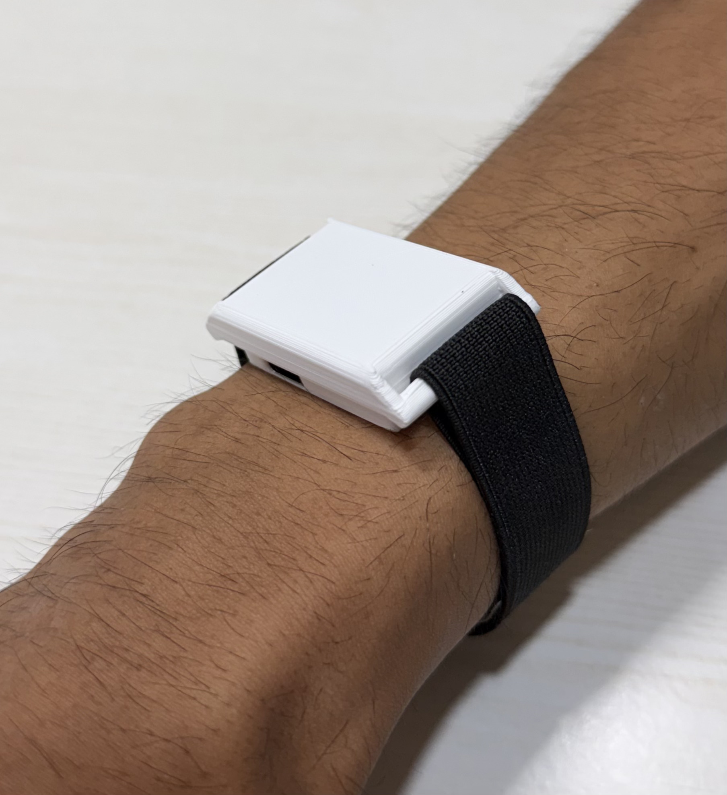
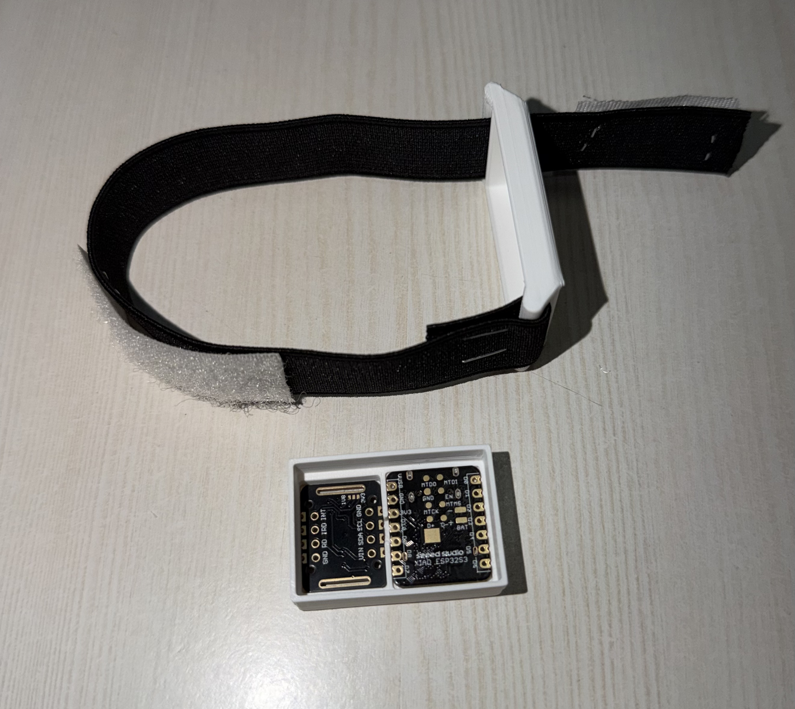

# Hardware

&nbsp;&nbsp; 
<em>Current prototype: XIAO nRF52840 Sense in a 3D-printed enclosure, MAX30102 finger sensor.</em>

## Bill of materials

| Component | Part | Role | Source of this information |
|---|---|---|---|
| MCU board | Seeed Studio XIAO nRF52840 Sense | BLE 5, Cortex-M4F @ 64 MHz with FPU, 1 MB flash, 256 KB RAM | vendor board |
| IMU | LSM6DS3 6-axis accel + gyro, I²C address `0x6A` | tremor, motion context, steps | firmware (`LSM6DS3 imu(I2C_MODE, 0x6A)`) |
| Optical sensor | MAX30102 (red 660 nm + IR 880 nm LEDs, 18-bit ADC) | PPG: HR, HRV, SpO₂ estimate, finger detection | firmware |
| Battery | 3.7 V 700 mAh Li-ion (902035) | power | `develop` README; not re-verified |
| Charging | USB-C on the XIAO board | charge + programming | board |
| Bus | I²C at 400 kHz (`Wire.setClock(400000)`) | both sensors | firmware |

Pin-level wiring and enclosure files are **not in the repository** (`hardware/` was empty and
has been removed). Wiring: MAX30102 on the board's default `Wire` I²C pins with 3.3 V and GND.
Record the exact harness in this file when it is next rebuilt.

## Why these parts

* **nRF52840** — BLE 5 with 2M PHY and data-length extension (a 208-byte packet fits one
  notification), hardware FPU, mature Arduino support through the Adafruit Bluefruit stack.
* **LSM6DS3** — accelerometer and gyroscope with configurable 104 Hz output data rate. The
  gyroscope is the primary tremor sensor: it measures the rotational oscillation of rest tremor
  directly and is insensitive to gravity.
* **MAX30102** — integrated red/IR LEDs and photodiode with a 32-sample FIFO, so the MCU can
  read in bursts without losing samples.

## Sensor configuration by firmware

| Setting | firmware v4 (`legacy/ble_stream_v4`) | firmware 5.0.0 (`parkinsense_wearable`) |
|---|---|---|
| IMU accelerometer range | intended ±4 g, **not applied** → driver default ±16 g | ±4 g, applied before `begin()` |
| IMU gyroscope range | intended ±245 dps, **not applied** → ±2000 dps | ±500 dps |
| IMU output data rate | driver default 416 Hz, sampled by the MCU at 104 Hz (aliasing possible) | 104 Hz (sensor's own digital filter is the anti-alias stage) |
| IMU read | six separate `readFloat*()` calls per sample | one 12-byte register burst (`OUTX_L_G`..`OUTZ_H_XL`) |
| MAX30102 | LED 0x1F, avg 1, red+IR, 100 SPS, 411 µs, 4096 nA range | same |
| PPG delivered to host | newest FIFO sample every 100 ms → **10 Hz** | newest FIFO sample every IMU tick → **~100 Hz** |
| MAX30102 I²C init speed | `I2C_SPEED_STANDARD` | `I2C_SPEED_FAST` (the bus clock is 400 kHz in both) |

v5 is not yet hardware-verified — see [firmware](../firmware/FIRMWARE.md) and
[hardware tests](../validation/HARDWARE_TEST_PROCEDURE.md).

## Sensor units on the wire and in software

| Quantity | Device | Wire | Host (Python) |
|---|---|---|---|
| Acceleration | raw LSB | int16 counts, 8192 per g | g |
| Angular rate | raw LSB | int16 counts, 131 per dps (v1) / 64 per dps (v2) | deg/s |
| PPG | 18-bit ADC counts | uint32 | counts (unitless) |
| Time | `micros()` | uint32 µs, packet header | unwrapped int64 µs, seconds of signal time |

## Finger gate (both firmware versions)

The device only streams while a finger covers the MAX30102:
IR > 50 000 counts for 3 consecutive 250 ms polls starts streaming; IR below it for 3 polls
stops it. Typical values recorded in the v4 source: no finger IR ≈ 1 600, finger IR ≈ 109 000.
v5 keeps this behaviour by default (`REQUIRE_FINGER_FOR_STREAMING = true`). Consequence: no
IMU data — and therefore no tremor or step data — without PPG contact.

## Power

No current measurements exist in the repository for any firmware. Earlier figures (~7 mA
active, µA sleep, ~100 h) are not supported by the v4 code, which has no sleep or
power-management calls (audit A-P0-4). v5 yields to the RTOS between samples; its effect is
unmeasured. Procedure: H5 in [hardware tests](../validation/HARDWARE_TEST_PROCEDURE.md).
