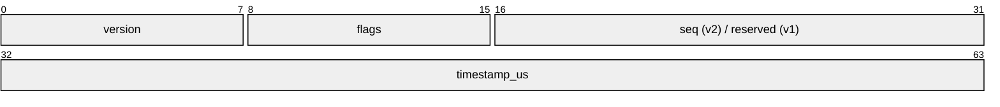
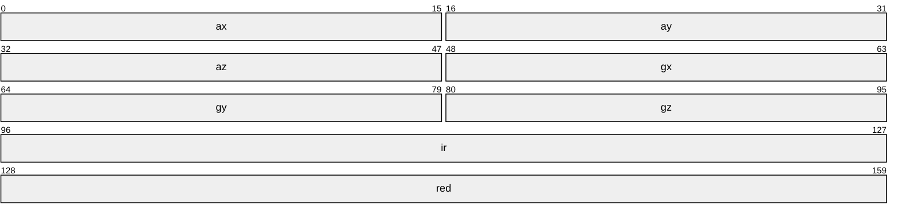

# ParkinSense BLE protocol (v1 and v2)

Host implementation: [`parkinsense/protocol/packet.py`](../../parkinsense/protocol/packet.py) — the only
host-side parser. Device implementation: [`firmware/parkinsense_wearable/packet.h`](../../firmware/parkinsense_wearable/packet.h)
(v2) and [`firmware/legacy/ble_stream_v4`](../../firmware/legacy/ble_stream_v4/parksense_ble_stream_v4.ino) (v1).

## GATT

| Item | UUID | Properties |
|---|---|---|
| Service | `ABCD1234-0000-467A-9538-01F0652C74E0` | — |
| Data characteristic | `ABCD1234-0001-467A-9538-01F0652C74E0` | notify, max 244 B; one packet per notification |
| Device Information · Firmware Revision String | `0x2A26` (`00002a26-0000-1000-8000-00805f9b34fb`) | read; **v2 firmware only** |

Advertised name: `ParkinSense`. ATT MTU 247. Notification rate ≈ 104 / 10 = 10.4 per second.

## Packet layout

Little-endian, packed (`#pragma pack(1)` / Python `struct` `<`). Framing is identical in v1
and v2: **208 bytes = 8-byte header + 10 × 20-byte samples**.

```text
byte  0        8                                                              208
      +--------+----------+----------+-----   ...   -----+----------+
      | header | sample 0 | sample 1 |                   | sample 9 |
      | 8 B    | 20 B     | 20 B     |                   | 20 B     |
      +--------+----------+----------+-----   ...   -----+----------+
```

Header (bits):



Sample (bits):



### Header (`<BBHI`)

| Offset | Size | Type | Field | v1 | v2 |
|---|---|---|---|---|---|
| 0 | 1 | u8 | `version` | `1` | `2` |
| 1 | 1 | u8 | `flags` | always `0` | bitfield, see below |
| 2 | 2 | u16 | `seq` | reserved, always `0` | packet sequence number, `0..65535`, wraps |
| 4 | 4 | u32 | `timestamp_us` | device `micros()` at sample 0 | same |

### Sample *i* (`<hhhhhhII`), at offset `8 + 20·i`

| Rel. offset | Size | Type | Field | Unit on wire | Host unit |
|---|---|---|---|---|---|
| 0 | 2 | i16 | `ax` | 8192 counts / g | g |
| 2 | 2 | i16 | `ay` | 8192 counts / g | g |
| 4 | 2 | i16 | `az` | 8192 counts / g | g |
| 6 | 2 | i16 | `gx` | v1: 131 counts / dps · v2: 64 counts / dps | deg/s |
| 8 | 2 | i16 | `gy` | 〃 | deg/s |
| 10 | 2 | i16 | `gz` | 〃 | deg/s |
| 12 | 4 | u32 | `ir` | MAX30102 18-bit ADC counts | counts |
| 16 | 4 | u32 | `red` | MAX30102 18-bit ADC counts | counts |

Representable range: accel ±4 g (both versions); gyro ±250 dps (v1) / ±512 dps (v2).

### v2 flags (byte 1)

| Bit | Mask | Name | Set when |
|---|---|---|---|
| 0 | `0x01` | `ACCEL_CLIPPED` | an accel value in this packet saturated or sat at the sensor rail |
| 1 | `0x02` | `GYRO_CLIPPED` | a gyro value saturated or sat at the sensor rail |
| 2 | `0x04` | `IMU_FAULT` | IMU not ready or burst read failed; IMU fields are 0 |
| 3 | `0x08` | `PPG_FAULT` | MAX30102 not ready; `ir`/`red` not valid |
| 4 | `0x10` | `PPG_STALE` | ≥ 1 slot repeated the previous PPG sample (100 SPS sensor vs 104 Hz slots) |
| 5 | `0x20` | `PREV_NOTIFY_FAILED` | the previous packet's `notify()` was rejected by the BLE stack |
| 6 | `0x40` | `TIME_DISCONTINUITY` | the scheduler skipped > 5 intervals; nominal sample times are approximate |
| 7 | `0x80` | — | reserved, 0 |

## Example bytes

Both packets below encode the same ten samples (`ax=0, ay=0, az=1 g, gx=12.5, gy=-3, gz=0.25 dps,
ir=110000+i, red=85000+i`), `timestamp_us = 1 000 000`, `seq = 7`, v2 `flags = PPG_STALE`.
Generated with `parkinsense.protocol.packet.encode` (first 28 bytes = header + sample 0):

```text
v1: 01 00 00 00 40 42 0f 00 | 00 00 00 00 00 20 | 66 06 77 fe 21 00 | b0 ad 01 00 | 08 4c 01 00
v2: 02 10 07 00 40 42 0f 00 | 00 00 00 00 00 20 | 20 03 40 ff 10 00 | b0 ad 01 00 | 08 4c 01 00
    hdr: ver flg seq  ts     | ax    ay    az     | gx    gy    gz     | ir          | red
```

* `40 42 0f 00` = 0x000F4240 = 1 000 000 µs.
* v1 `gx` = `66 06` = 1638 → 1638 / 131 = 12.504 dps (wire quantisation 1/131 dps).
* v2 `gx` = `20 03` = 800 → 800 / 64 = 12.5 dps; `seq` = `07 00` = 7; `flags` = `0x10`.
* v1 ignores the `seq` argument (field stays 0).

## Decoding

```python
from parkinsense.protocol import packet as P

unwrap = P.TimestampUnwrapper()
seq = P.SequenceTracker()
pkt = P.decode(data, unwrap)          # raises P.ProtocolError on bad length / unknown version
lost_before = seq.update(pkt.seq)     # v1: pkt.seq is None -> 0
for s in pkt.samples:                 # 10 x Sample(device_time_us, ax..gz, ir, red, possibly_clipped)
    ...
```

Rules implemented by `decode`:

1. `len(data) != 208` → `ProtocolError`.
2. `version ∉ {1, 2}` → `ProtocolError`. Scales are selected **by version**; an old recording is
   never decoded with new scales.
3. `seq` is returned as `None` for v1.
4. Per-sample device time = unwrapped header time + `i × 9615 µs`.
5. `possibly_clipped` = any of the six int16 values within 1 % of full scale. For v1 this marks
   samples that may have wrapped on the device (unrecoverable).

## Encoding (replay, tests, benchmarks)

```python
data = P.encode(rows, timestamp_us, version=2, seq=n, flags=0)
# rows: 10 tuples (ax, ay, az, gx, gy, gz, ir, red) in physical units
```

`encode` rounds to the nearest count and saturates, so `encode(decode(x)) == x` byte-for-byte
(`tests/unit/test_protocol.py::test_roundtrip_exact`). This is what makes replay bit-exact.

## Timestamps and rollover

`timestamp_us` is the device's 32-bit `micros()`, which wraps every 2³² µs = 71 min 34.97 s.
`TimestampUnwrapper` keeps a 64-bit offset:

* new value < previous **by more than 2³¹** → a wrap: add 2³² to the offset, `wraps += 1`;
* new value < previous by less → a genuine backward step (reordering / reset): counted in
  `backward_steps`, *not* "corrected".

Device sample rate is measured from consecutive header timestamps over the last 100 packets:
$\hat f_s = 10\,(N-1)/(t_{N}-t_{1})$. Status: `OK` within 2 % of 104 Hz, `WARN` within 5 %,
`INVALID` beyond.

## Loss detection

| Mechanism | Versions | Implementation |
|---|---|---|
| Sequence gaps (`(seq − expected) mod 65536`, < 32768 = lost, else duplicate/reorder) | v2 | `SequenceTracker` |
| Timestamp gaps (> 1.5 sample periods between packets) | v1 and v2 | `GapDetector` |

A gap longer than 0.5 s makes the runtime discard all windowed state (`RuntimeEngine.reset_windows`)
so no analysis window spans a discontinuity. All counters are written to every
`metadata.json` (see [runtime](../runtime/RUNTIME_AND_RECORDING.md)).

## Error handling summary

| Condition | Host behaviour |
|---|---|
| Wrong length / unknown version | packet rejected, `bad_packets += 1`, logged; stream continues |
| Lost packets (v2) | counted (`packets_lost` on the next row; `packets_lost_seq` in metadata) |
| Timestamp gap > 0.5 s | counted, windows reset, `gap_before_s` on the next row |
| Measured rate > 5 % off | `rate_status = INVALID`; tremor quality `DATA_GAP`, HR quality `RATE_INVALID` |
| v1 sample near full scale | `possibly_clipped = true` on the row; windows with > 2 % such samples → tremor quality `SENSOR_FAULT` |

## Compatibility rules

1. The 208-byte framing and field order never change within a protocol major version.
2. New meaning requires a new `version` value and a new decoder branch.
3. The host keeps decoders for every version ever shipped; v1 recordings stay readable.
