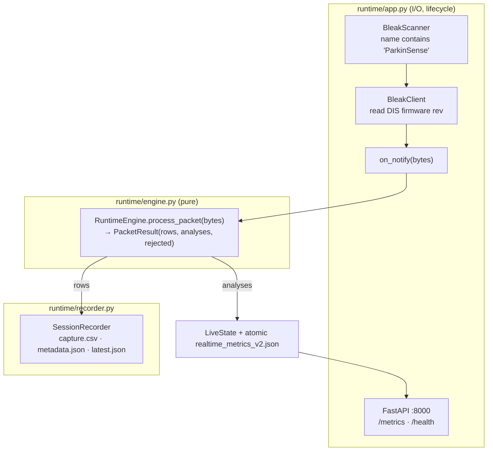
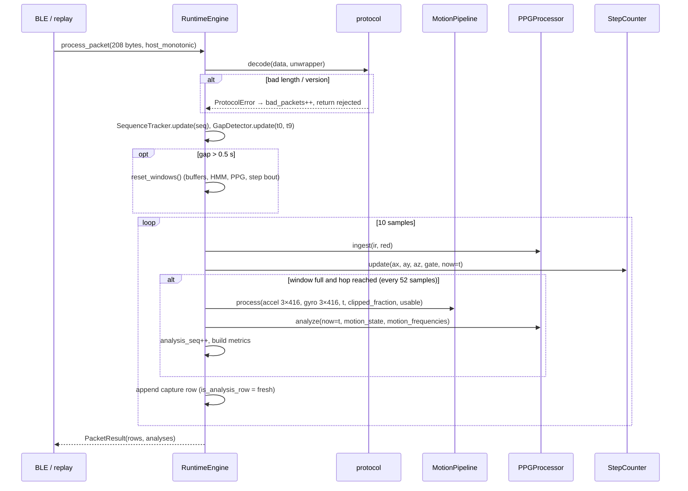

# Runtime, recording and data lifecycle

Implementation: [`runtime/engine.py`](../../parkinsense/runtime/engine.py) (processing core),
[`runtime/recorder.py`](../../parkinsense/runtime/recorder.py) (files),
[`runtime/app.py`](../../parkinsense/runtime/app.py) (BLE, API, lifecycle).
Tests: [`tests/integration/test_engine.py`](../../tests/integration/test_engine.py),
[`tests/integration/test_replay_and_recording.py`](../../tests/integration/test_replay_and_recording.py).
Decisions: [ADR-0001](../decisions/0001-two-clock-runtime-scheduling.md),
[ADR-0003](../decisions/0003-capture-column-time-bases.md),
[ADR-0006](../decisions/0006-runtime-engine.md).

## 1. Components



`RuntimeEngine` performs no I/O, holds no globals and never reads the wall clock for
processing. Importing it creates no files (`test_import_has_no_side_effects`). The same engine
runs under the live app, replay, the dataset builder, the benchmarks and the tests.

## 2. Per-packet processing



## 3. Time

| Clock | Column | Used for |
|---|---|---|
| **Signal time** $t = (T_{dev} - T_{dev,0})/10^6$ s, from the unwrapped device timestamp | `device_time_us` | **all** temporal logic: HMM, PPG hysteresis/throttle/SpO₂ lock, step timing |
| Host monotonic | `host_monotonic` | provenance, link-latency analysis |
| Host wall clock | `timestamp` | human-readable provenance only |
| Raw device 32-bit | `sample_timestamp_us` | backwards compatibility with v2 readers |

Because outputs depend only on packet contents and signal time, a session replayed at any speed
reproduces the live analyses exactly (`test_live_and_replay_are_identical`,
`test_replay_is_deterministic`).

Timestamp unwrapping, sequence tracking and gap detection are specified in the
[protocol](../protocol/BLE_PROTOCOL.md#timestamps-and-rollover).

## 4. Scheduling: two clocks

| Path | Rate | Work |
|---|---|---|
| per sample | 104 Hz | decode, PPG ingest, step counter, capture row |
| per analysis | every 52 samples (0.5 s) once 416 samples (4 s) are buffered | motion features, context, tremor evidence + HMM, PPG analysis, metrics |

The first analysis runs as soon as the window is full, and again immediately after a window
reset. Rows are written from the **first sample**; analysis columns are empty until the first
analysis (v2.2 wrote nothing for the first 4 s).

## 5. Integrity and validation

| Check | Mechanism | Effect |
|---|---|---|
| malformed packet | `decode` raises | `bad_packets++`, packet dropped |
| lost packets (v2) | sequence numbers | `packets_lost` on next row; counters in metadata |
| timestamp gap | > 1.5 sample periods | `gap_before_s`; > 0.5 s → `reset_windows()` |
| timestamp wrap | `TimestampUnwrapper` | continuous `device_time_us`; `timestamp_wraps` counted |
| device rate | last 100 header timestamps | `rate_status` OK ≤ 2 % · WARN ≤ 5 % · INVALID; INVALID → tremor window unusable (`DATA_GAP`), HR `RATE_INVALID` |
| v1 near-full-scale samples | `possibly_clipped` | > 2 % of a window → tremor quality `SENSOR_FAULT` |
| analysis exception | try/except in `_analyse` | `analysis_errors++`, first traceback logged, `last_error` kept; 20 consecutive → `RuntimeError` |

## 6. Quality states

Shared vocabulary `config.Quality`. Anything other than `VALID` means "do not interpret as a
measurement".

| State | Tremor (`tremor_quality`) | Heart rate (`hr_quality_state`) |
|---|---|---|
| `VALID` | usable window; not confirmed tremor, or confirmed with P ≥ 0.95 | confident HR |
| `LOW_CONFIDENCE` | tremor confirmed but 0.8 ≤ P < 0.95 | overall confidence < 0.35 |
| `MOTION_ARTIFACT` | — | HR within 0.12 Hz of the motion fundamental or 2nd harmonic |
| `NO_CONTACT` | — | no finger |
| `INSUFFICIENT_DATA` | — | no HR estimate (buffer too short / too few beats) |
| `DATA_GAP` | window unusable (rate invalid) | — |
| `SENSOR_FAULT` | > 2 % of window samples possibly clipped | — |
| `RATE_INVALID` | — | device rate > 5 % off nominal |

## 7. Session recording

`SessionRecorder(engine, root="recordings")` is a context manager. On enter it creates
`recordings/<YYYYmmdd_HHMMSS>_<session_id>/`, opens `capture.csv`, writes `metadata.json`
(`status: RECORDING`) and `recordings/latest.json` (pointer for the dashboard). Rows are flushed
after every packet. On exit — normal, BLE disconnect, Ctrl-C, SIGTERM or exception — the file is
fsynced and closed and `metadata.json` is rewritten with `COMPLETE` or `ABORTED:<Exception>`.
JSON files are written atomically (temp file + `os.replace`). The live app refreshes
`metadata.json` every 10 s; after a disconnect it reconnects into a **new** session.

### metadata.json (actual output of a synthetic 12 s session; host fields redacted)

```json
{
  "session_id": "docexample",
  "status": "COMPLETE",
  "capture_schema_version": "3",
  "pipeline_version": "3.0.0",
  "tremor_algorithm_version": "3.0",
  "step_counter_version": "2.0",
  "ppg_version": "2.0",
  "firmware_version": "5.0.0",
  "protocol_versions_seen": [
    2
  ],
  "config": {
    "nominal_sample_rate_hz": 104.0,
    "window_samples": 416,
    "analysis_hop_samples": 52,
    "ppg_slot_rate_hz": 104.0,
    "ppg_window_seconds": 10.0,
    "tremor_band_hz": [
      3.5,
      7.5
    ],
    "batch_size": 10
  },
  "measured": {
    "device_rate_hz": 104.00416016640665,
    "rate_status": "OK",
    "samples": 1240,
    "rows_written": 1240,
    "analyses": 16
  },
  "integrity": {
    "packets": 124,
    "bad_packets": 0,
    "packets_lost_seq": 0,
    "loss_fraction_seq": 0.0,
    "timestamp_gaps": 0,
    "missing_samples_est": 0,
    "timestamp_wraps": 0,
    "timestamp_backward_steps": 0,
    "window_resets": 0,
    "analysis_errors": 0,
    "protocol_versions": [
      2
    ]
  },
  "started_utc": "<utc>",
  "ended_utc": "<utc>",
  "duration_host_s": "<s>",
  "device": {},
  "host": {
    "platform": "<host platform>",
    "python": "<version>"
  },
  "notes": ""
}
```

`step_counter_version` reads `2.0` although the default counter is v1.1 — see the known discrepancy in [activity](../algorithms/ACTIVITY.md).

### capture.csv — schema v3 (79 columns)

Columns 1–52 are the v2 schema in its original order (name-based readers of v2 files keep
working); 53–79 are appended. Time base per [ADR-0003](../decisions/0003-capture-column-time-bases.md).

| # | Column | Time base | Meaning |
|---|---|---|---|
| 1 | `timestamp` | per sample | host wall clock, s since epoch (provenance only) |
| 2 | `sample_timestamp_us` | per sample | device micros() of this sample, 32-bit (wraps) |
| 3 | `ax` | per sample | acceleration X, g |
| 4 | `ay` | per sample | acceleration Y, g |
| 5 | `az` | per sample | acceleration Z, g |
| 6 | `gx` | per sample | angular rate X, deg/s |
| 7 | `gy` | per sample | angular rate Y, deg/s |
| 8 | `gz` | per sample | angular rate Z, deg/s |
| 9 | `ir` | per sample | MAX30102 IR, ADC counts |
| 10 | `red` | per sample | MAX30102 red, ADC counts |
| 11 | `classification` | per analysis (forward-filled) | `TREMOR` / `NO TREMOR` (HMM confirmed) |
| 12 | `tremor_score` | per analysis (forward-filled) | round(100 × window evidence) |
| 13 | `confidence` | per analysis (forward-filled) | 100 × P(tremor) |
| 14 | `severity` | per analysis (forward-filled) | `NONE` or `NOT_ASSESSED` (no clinical severity) |
| 15 | `dominant_frequency` | per analysis (forward-filled) | interpolated tremor-band peak, Hz |
| 16 | `frequency_std` | per analysis (forward-filled) | tremor-power-weighted std of axis peaks, Hz |
| 17 | `band_ratio` | per analysis (forward-filled) | tremor power / 0.5–15 Hz power |
| 18 | `best_axis` | per analysis (forward-filled) | `gx`/`gy`/`gz` with most tremor power |
| 19 | `axis_agreement` | per analysis (forward-filled) | clip(1 − frequency_std/2) |
| 20 | `axis_dominance` | per analysis (forward-filled) | max axis tremor power / sum |
| 21 | `rest_index` | per analysis (forward-filled) | max(0, 1 − motion_rms/0.20) |
| 22 | `motion_state` | per analysis (forward-filled) | `REST` / `LOW MOTION` / `ACTIVE` |
| 23 | `motion_rms` | per analysis (forward-filled) | 0.2–3 Hz linear-acceleration vector RMS, g |
| 24 | `steps` | per sample | cumulative steps |
| 25 | `cadence` | per sample | steps/min |
| 26 | `step_rate_hz` | per sample | cadence / 60 |
| 27 | `walking_state` | per sample | `WALKING` / `NOT_WALKING` |
| 28 | `distance_m` | per sample | steps × step length |
| 29 | `active_minutes` | per sample | qualified walking minutes |
| 30 | `step_confidence` | per sample | 0–1 |
| 31 | `walking_confidence` | per sample | 0–1 |
| 32 | `activity_type` | per sample | `walking` or empty |
| 33 | `heart_rate` | per analysis (forward-filled) | EMA-smoothed BPM (see `hr_quality_state`) |
| 34 | `spo2` | per analysis (forward-filled) | **uncalibrated** estimate, % |
| 35 | `hr_confidence` | per analysis (forward-filled) | HR estimator confidence 0–1 |
| 36 | `spo2_confidence` | per analysis (forward-filled) | 0–1 |
| 37 | `signal_quality` | per analysis (forward-filled) | PPG SQI 0–100 |
| 38 | `sensor_status` | per analysis (forward-filled) | `NO_FINGER`/`LOW_SIGNAL`/`POOR_SIGNAL`/`GOOD`/`HIGH_SIGNAL`/`SATURATED` |
| 39 | `finger_detected` | per analysis (forward-filled) | hysteresis-confirmed finger contact |
| 40 | `rmssd` | per analysis (forward-filled) | ms (None if withheld) |
| 41 | `sdnn` | per analysis (forward-filled) | ms |
| 42 | `mean_rr` | per analysis (forward-filled) | ms |
| 43 | `pnn50` | per analysis (forward-filled) | % |
| 44 | `sample_count` | per sample | running sample index (unique per row) |
| 45 | `packet_count` | per packet | packets accepted so far |
| 46 | `sampling_rate` | per analysis (forward-filled) | **measured device rate**, Hz (v2: host arrival rate) |
| 47 | `packet_version` | per packet | protocol version of this sample's packet |
| 48 | `flags` | per packet | packet flags (v2) |
| 49 | `pipeline_version` | per session | `3.0.0` |
| 50 | `firmware_version` | per session | from DIS (v5) or `--firmware-version` |
| 51 | `step_counter_version` | per session | see known discrepancy in ACTIVITY.md |
| 52 | `ppg_version` | per session | `2.0` |
| 53 | `session_id` | per session | 12-hex session identifier |
| 54 | `host_monotonic` | per sample | host `time.monotonic()` at packet arrival, s |
| 55 | `device_time_us` | per sample | unwrapped 64-bit device time of this sample |
| 56 | `packet_seq` | per packet | v2 sequence number (empty for v1) |
| 57 | `packets_lost` | per packet | packets lost immediately before this packet (first row of packet only) |
| 58 | `gap_before_s` | per packet | timestamp gap before this packet, s (first row only) |
| 59 | `possibly_clipped` | per sample | any IMU value within 1 % of full scale |
| 60 | `is_analysis_row` | per sample | true on the row whose arrival triggered an analysis |
| 61 | `analysis_seq` | per analysis (forward-filled) | analysis counter (1, 2, …); same value forward-filled until the next analysis |
| 62 | `tremor_state` | per analysis (forward-filled) | `NO_TREMOR`/`POSSIBLE_TREMOR`/`CONFIRMED_TREMOR`/`RECOVERY` |
| 63 | `tremor_probability` | per analysis (forward-filled) | HMM posterior 0–1 |
| 64 | `tremor_evidence` | per analysis (forward-filled) | window evidence 0–1 |
| 65 | `tremor_type` | per analysis (forward-filled) | `REST`/`ACTION`/`NONE` |
| 66 | `tremor_amplitude_dps` | per analysis (forward-filled) | tremor RMS angular rate, deg/s |
| 67 | `tremor_power` | per analysis (forward-filled) | (deg/s)² |
| 68 | `tremor_snr_db` | per analysis (forward-filled) | dB |
| 69 | `arm_movement_rms_dps` | per analysis (forward-filled) | 0.5–3 Hz gyro RMS, deg/s |
| 70 | `tremor_quality` | per analysis (forward-filled) | quality state |
| 71 | `hr_quality_state` | per analysis (forward-filled) | quality state |
| 72 | `ppg_effective_rate_hz` | per analysis (forward-filled) | distinct PPG samples/s |
| 73 | `motion_coupled_hr` | per analysis (forward-filled) | HR coincides with motion frequency |
| 74 | `device_rate_hz` | per analysis (forward-filled) | measured device rate, Hz |
| 75 | `rate_status` | per analysis (forward-filled) | `OK`/`WARN`/`INVALID`/`UNKNOWN` |
| 76 | `nominal_rate_hz` | per session | 104.0 |
| 77 | `analysis_hop_samples` | per session | 52 |
| 78 | `capture_schema_version` | per session | `3` |
| 79 | `tremor_algorithm_version` | per session | `3.0` |

**Using the capture correctly:** for any window-level analysis, filter
`is_analysis_row == True` (or group by `analysis_seq`). Per-sample rows repeat the last window's
values ~52 times; treating them as independent observations inflates sample size and leaks
between train and test sets (review P0-2).

## 8. Live metrics (`/metrics`, `realtime_metrics_v2.json`)

The latest analysis as JSON: every analysis column above plus `hr_quality` (dict of HR
sub-scores), `latest_ir`, `latest_red`, `signal_time_s`, `motion_pipeline_state`,
`integrity` (the metadata integrity block), `status` (`WAITING`/`STREAMING`/`DISCONNECTED`)
and `capture_path`. Keys are only ever added — v2 consumers keep working. `/health` returns
`status`, `integrity` and `rate_status`. `/live` serves incremental raw samples and analyses
(by sequence number) for the dashboard; `/session` and `POST /session/{start,stop}` control
sessions. `python -m parkinsense.runtime.app` binds `0.0.0.0:8000` by default (v2 behaviour,
needed by the phone app on the LAN); the launch scripts bind `127.0.0.1` unless `--host` is given.
`--simulate` and `--replay CSV` run the same engine and recorder on a synthetic or recorded
stream; such sessions record `device.source` = `simulated` / `replay`.
Details: [dashboard and API](../software/DASHBOARD_AND_API.md).

## 9. Running

```bash
parkinsense-live                                   # = python -m parkinsense.runtime.app
parkinsense-live --firmware-version 4.0 --notes "seated rest, left wrist"
parkinsense-live --once --no-api --out /data/recordings
```

| Option | Default | Meaning |
|---|---|---|
| `--firmware-version` | `unknown` | recorded when the device cannot report it (firmware ≤ v4) |
| `--out` | `recordings` | session root |
| `--metrics-file` | `realtime_metrics_v2.json` | atomic live metrics file |
| `--host` / `--port` | `0.0.0.0` / `8000` | API bind |
| `--no-api` | off | do not start FastAPI |
| `--once` | off | exit after the first disconnect instead of reconnecting |
| `--notes` | empty | free text stored in metadata.json |
