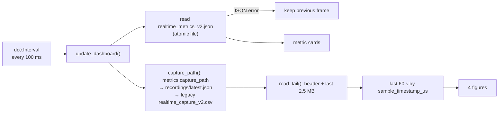

# Dashboard and live API

<p align="center">
&nbsp;<br>
<em>Dashboard photos from pipeline 2.x. Card set has since changed (see below); layout and graphs are the same.</em>
</p>

## Dashboard

```bash
parkinsense-live                                  # in one terminal (produces the data)
python -m parkinsense.visualization.dashboard     # in another → http://127.0.0.1:8050
```

Implementation: [`visualization/dashboard.py`](../../parkinsense/visualization/dashboard.py) (Plotly Dash).
It imports **nothing** from the processing packages; it only reads files written by the runtime,
so processing can be replayed or changed without touching the UI.

### Data sources and update loop



| Setting | Value | Override |
|---|---|---|
| metrics file | `realtime_metrics_v2.json` | env `PARKINSENSE_METRICS` |
| session pointer | `recordings/latest.json` | env `PARKINSENSE_LATEST` |
| refresh | 100 ms | code |
| tail read | 2 500 000 bytes (≈ 70 s of v3 rows) | `TAIL_BYTES` |
| graph window | 60 s of device time | `HISTORY_SECONDS` |

**Performance.** v2 re-read the whole capture CSV on every 100 ms tick; at ~100 rows/s the file
reaches hundreds of MB within hours and each refresh took seconds. `read_tail` seeks to the last
2.5 MB, drops the partial first line and parses only that, so cost is constant regardless of
session length. The read is not tested at multi-hour file sizes on real hardware.

**Robustness.** The metrics file is written atomically; if a read still fails (`OSError`,
`JSONDecodeError`) the previous frame is kept rather than blanking to "WAITING" (review P2-10).

### Cards

| Section | Cards |
|---|---|
| Parkinson's | Status (`classification`), Tremor Score (window evidence × 100), Frequency, Amplitude (°/s), Tremor State, P(tremor), Data Quality (`tremor_quality` / `rate_status`), Motion, Rest Index, Best Axis, Band Ratio |
| Activity | Steps, Cadence, Distance, Walking, Active Minutes |
| Vitals | Heart Rate (with `hr_quality_state` unless VALID), SpO₂ (always labelled *UNCALIBRATED ESTIMATE*), Finger |

Removed vs v2: *Severity* (no clinical basis), *Burden* (read a key the runtime never wrote),
*Confidence* (replaced by P(tremor)).

### Graphs

Live gyroscope (gx, gy, gz), tremor-score gauge (0–100 of `tremor_score`, which is now the
per-window evidence, so zone colours are indicative only), heart rate & SpO₂ trend, cadence
trend.

Not shown yet: HRV values, SQI, sensor status, quality-state history, integrity counters.

## Live API

Started by `parkinsense-live` (disable with `--no-api`); FastAPI on `0.0.0.0:8000` by default.

| Endpoint | Returns |
|---|---|
| `GET /metrics` | latest analysis (same keys as `realtime_metrics_v2.json`), or `{"status": "WAITING"}` / `{"status": "DISCONNECTED", "integrity": {...}}` |
| `GET /health` | `{"status", "integrity", "rate_status"}` |

Compatibility: every v2 key is still present; new keys are additive. Consumers should check
`tremor_quality` and `hr_quality_state` before displaying a value as a measurement. The metrics
are strict JSON (no NaN; `test_published_metrics_are_strict_json`).

Security: the API has no authentication and binds all interfaces by default (needed for a phone
on the same LAN). Use `--host 127.0.0.1` on untrusted networks.
