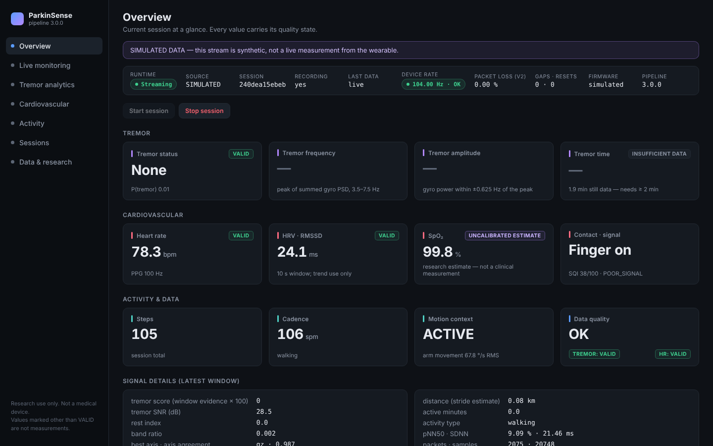
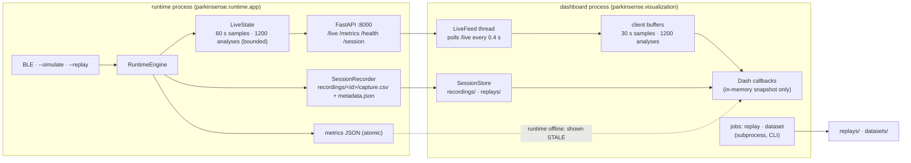

# Dashboard and live API

<p align="center">
<br>
<em>Overview page, simulated stream (the SIMULATED banner is shown whenever the data is not from the wearable).</em>
</p>

## Run it

```bash
./start_parkinsense.sh --simulate     # runtime + dashboard, no hardware → http://127.0.0.1:8050
./start_parkinsense.sh                # wearable over BLE
```

Or in two terminals: `./start_runtime.sh` and `./start_dashboard.sh`. All scripts:
[launch scripts](#launch-scripts).

## Architecture



### Rules the design enforces

| Rule | How |
|---|---|
| The dashboard is a consumer, not a second implementation | It never imports `RuntimeEngine` or the motion/PPG detectors. Session summaries call `parkinsense.analytics`; the PSD inspector calls `motion.features.gyro_spectrum` on raw rows already recorded. Replay and datasets run the project CLIs in a subprocess. |
| No full-CSV re-reads on the UI path | Live data comes from the incremental `/live` endpoint. History is read once per (file, size, mtime) with `usecols` and chunking, and cached (LRU, 6 sessions); raw windows are read through a sparse line index. |
| Bounded memory | Every live buffer is a fixed-size `deque` on both sides; a long session does not grow them (measured below). |
| Independent restart | Runtime and dashboard are separate processes. Restarting the dashboard loses nothing; restarting the runtime makes the dashboard show *Runtime offline* until it returns, then resynchronise (sequence numbers reset → buffers cleared). |
| Originals never modified | The dashboard opens recordings read-only. Replay writes `replays/<session>_<time>/`; dataset generation refuses an existing `datasets/<version>/`. |

## Pages

| Page | What it shows | Source |
|---|---|---|
| **Overview** | status bar (runtime, source, session, recording, data age, device rate, v2 packet loss, gaps/resets, firmware, pipeline), session start/stop, tremor / cardiovascular / activity cards with quality badges, signal details (tremor score, SNR, rest index, band ratio, best axis, distance, active minutes, pNN50, packets), 10-min HR and P(tremor) trends | live |
| **Live monitoring** | last 10 s accelerometer, gyroscope, PPG (IR, baseline removed for display); 2 min of tremor frequency + P(tremor), HR by quality, measured sample rate with ±2 % limits, motion context | live |
| **Tremor analytics** | tremor time / frequency / power summary (analytics thresholds), P(tremor) with published-TREMOR shading, frequency and amplitude per detected window, tremor power vs purposeful arm movement, motion context, detected episodes table, **click a window → its gyro PSD**, multi-session comparison | live buffer or any session |
| **Cardiovascular** | HR coloured by quality with motion-artefact and no-contact shading, RMSSD/SDNN (or the reason HRV is withheld), SQI and HR confidence, SpO₂ under a permanent *uncalibrated estimate* banner | live buffer or any session |
| **Activity** | cumulative steps with walking shading, steps counted outside confirmed walking marked *uncertain*, cadence while walking, detector confidence, motion context | live buffer or any session |
| **Sessions** | every recording and replay with source, duration, status, firmware, pipeline, rate, loss, gaps, errors, size; full metadata; export raw CSV, metadata JSON, session summary JSON (metadata + integrity + quality fractions + `session_report` + episodes) | disk |
| **Data & research** | deterministic replay job, dataset generation job, job log, pipeline configuration (read-only), baseline vs current benchmark table | disk + CLI |

Inter-beat intervals (RR series) are not in capture schema v3, so the
Cardiovascular page says so instead of drawing an empty chart.

## Quality semantics in the UI

States come from the runtime (`config.Quality`); the UI only maps them
([`visualization/quality.py`](../../parkinsense/visualization/quality.py)).

| State | Badge | Card value | Charts |
|---|---|---|---|
| `VALID` | green | normal | solid markers / lines |
| `LOW_CONFIDENCE` | amber | muted + badge | hollow markers |
| `MOTION_ARTIFACT` | orange | muted + badge | hollow markers; shaded interval on HR |
| `NO_CONTACT`, `INSUFFICIENT_DATA` | grey | `—` or muted + badge | hollow / gap; no-contact shading on HR |
| `DATA_GAP`, `SENSOR_FAULT`, `RATE_INVALID` | red | muted + badge | hollow markers |
| *STALE* (display only) | grey | muted + badge on every card | — |
| *OFFLINE* (display only) | grey | last file values, muted, banner | — |
| *ESTIMATE* (SpO₂) | violet | value + permanent badge | separate chart under a disclaimer |

Missing values are always `—`, never `0` (`components.fmt`, tested). Data older
than 3 s is never shown as live: the status bar turns amber and every card is
marked stale. Simulated and replayed streams carry a banner on every page, and
`metadata.json` records `device.source` = `simulated` / `replay`.

## Charts

Plotly with a project template (dark theme, units on every axis, unified hover,
zoom/pan, scroll-zoom, PNG export from the mode bar). Live charts keep the
user's zoom across updates (`uirevision`). Long line series are decimated for
display with a min/max-preserving reducer (`charts.decimate`, ≤ 4 000 points), so
peaks survive. Interval shading (tremor, walking, artefact, no contact) is one
filled trace per category, so its cost does not grow with the number of intervals.
Categorical state over time is drawn as a strip chart.

## Live API

Started with the runtime (`--no-api` disables it). FastAPI; `127.0.0.1:8000`
from the launch scripts, `0.0.0.0:8000` when `parkinsense-live` is run directly
(so a phone on the LAN can connect).

| Endpoint | Returns |
|---|---|
| `GET /live?since_sample=N&since_analysis=M&max_samples=K` | samples and analyses newer than the given sequence numbers, plus `status`, `source`, `recording`, `session_id`, `last_packet_age_s`, `integrity`, `last_sample_seq`, `last_analysis_seq`, `sample_fields` (`seq, t, ax, ay, az, gx, gy, gz, ir, red`). At most 4 000 samples per response (the newest). |
| `GET /metrics` | latest analysis (all keys of `realtime_metrics_v2.json`), or `{"status": "WAITING"}` / `"DISCONNECTED"` |
| `GET /health` | `{"status", "integrity", "rate_status"}` |
| `GET /session` | current session, source, recording state, last packet age |
| `POST /session/stop` | finalise the current session (metadata COMPLETE); runtime stays up, idle |
| `POST /session/start` | start a new session |

Compatibility: every key of the 2.x `/metrics` is still present; new endpoints
are additive. The metrics are strict JSON (no NaN).

Security: no authentication. Keep the default `127.0.0.1` unless you need LAN
access, and then only on a trusted network.

## Launch scripts

| Script | Purpose |
|---|---|
| `./setup.sh` | create `./.venv` (or reuse an existing env — never deleted without `--recreate`), install `.[live,dashboard,dev]` |
| `./start_runtime.sh [--simulate \| --replay FILE]` | runtime in the foreground; Ctrl+C finalises the session |
| `./start_dashboard.sh` | dashboard in the foreground; independent of the runtime |
| `./start_parkinsense.sh [--simulate \| --replay FILE]` | both, health-checked, logs in `./logs/`, one Ctrl+C stops runtime (cleanly) then dashboard |
| `./check.sh [--quick]` | the CI checks locally: lint, pytest (incl. golden), benchmark smoke, firmware host tests, doc links |
| `./replay.sh SESSION` | deterministic offline replay → `replays/` |
| `./clean.sh [--yes]` | remove caches, pid files, legacy metrics (dry run by default; never recordings, replays, datasets or the venv) |

No activation needed: the scripts use `$PARKINSENSE_PYTHON`, an active venv,
`./.venv` or `./venv`, in that order. Every script has `--help`. Exit codes:
`0` ok, `1` environment, `2` usage, `3` port in use / already running, `4` a
component failed to start. A separate `dashboard_only.sh` is not provided:
`./start_dashboard.sh` already runs without a runtime (sessions, replays and an
explicit *Runtime offline* state).

## Configuration

| Setting | Default | Override |
|---|---|---|
| runtime API | `http://127.0.0.1:8000` | `--api`, env `PARKINSENSE_API` |
| recordings / replays | `recordings/`, `replays/` | env `PARKINSENSE_RECORDINGS`, `PARKINSENSE_REPLAYS` |
| metrics fallback file | `realtime_metrics_v2.json` | env `PARKINSENSE_METRICS` |
| poll interval / timeout | 0.4 s / 1 s | `datasource.py` |
| stale after | 3 s without new data | `datasource.STALE_AFTER_S` |
| client buffers | 30 s samples, 1 200 analyses | `datasource.py` |
| runtime buffers | 60 s samples, 1 200 analyses | `runtime/app.py` |
| pid files / logs | `.run/`, `logs/` | env `PARKINSENSE_RUN_DIR`, `PARKINSENSE_LOG_DIR` |

## Performance

`python -m benchmarks.dashboard_bench --minutes 60` records a 60-minute
simulated session with the real engine and recorder, then times the live and
history paths. Results and the before/after comparison:
[Dashboard 2.0 report](../audit/DASHBOARD_2_REPORT.md).

## Tests

`tests/integration/test_dashboard.py` (LiveState incremental + bounded, LiveFeed
against a real uvicorn server incl. runtime going away, session reset, session
store read-only with hash check, every page builds, figures with and without
data, offline rendering without zeros, decimation keeps extremes) and
`tests/integration/test_launchers.py` (help and usage errors for every script,
missing environment, port conflict, duplicate runtime, full
start → health → Ctrl+C → metadata COMPLETE cycle).
