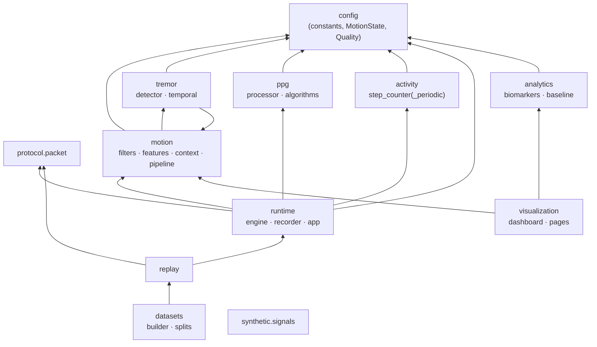

# Python package reference (`parkinsense` 3.0.0)

Install: `pip install -e ".[live,dashboard,dev]"` (Python ≥ 3.10). Core dependencies: numpy,
scipy, pandas. Optional: `live` = bleak, fastapi, uvicorn; `dashboard` = dash, plotly;
`dev` = pytest, flake8. Entry points (`pyproject.toml`): `parkinsense-live`,
`parkinsense-replay`, `parkinsense-dataset`.

## Dependency structure

Arrows point from a module to what it imports. There are no cycles; `protocol`, `config` and
`synthetic` import nothing else from the package.

(`motion.pipeline` imports `tremor.detector`/`tremor.temporal`, and `tremor.detector` imports
the `SpectralFeatures` type from `motion.features`; there is no import cycle at module level.)
`visualization` never imports the runtime engine or the detectors: it reads the runtime's HTTP
API and recorded files, uses `analytics` for session summaries and `motion.features.gyro_spectrum`
only to show the spectrum of an already-recorded window.

---

## `config`

**Responsibility:** constants shared by more than one module; version strings; shared enums.
**Public:** `PIPELINE_VERSION="3.0.0"`, `CAPTURE_SCHEMA_VERSION="3"`, `TREMOR_ALGORITHM_VERSION`,
`STEP_COUNTER_VERSION`, `PPG_VERSION`, `SAMPLE_RATE_HZ=104.0`, `WINDOW_SAMPLES=416`,
`ANALYSIS_HOP_SAMPLES=52`, `PPG_SLOT_RATE_HZ`, `PPG_WINDOW_SECONDS=10`, `RATE_WARN_FRACTION=0.02`,
`RATE_INVALID_FRACTION=0.05`, `MAX_GAP_BEFORE_RESET_S=0.5`, `TREMOR_BAND_HZ=(3.5, 7.5)`,
`ARM_MOVEMENT_BAND_HZ=(0.5, 3.0)`, `ANALYSIS_BAND_HZ=(0.5, 15.0)`, `MotionState`, `Quality`.
**Rule:** module-private tuning constants stay in their module next to the code they tune.
Changing anything here that changes how a recording is interpreted requires a version bump and
an ADR ([contributing](../development/CONTRIBUTING.md)).

## `protocol.packet`

**Responsibility:** the only BLE packet parser/encoder; stream integrity.
**Public:** `decode(data, unwrapper=None) -> Packet`, `encode(rows, timestamp_us, version, seq, flags) -> bytes`,
`Packet`, `Sample`, `PacketFlags`, `SCALES`, `ProtocolError`, `TimestampUnwrapper`,
`SequenceTracker`, `GapDetector`, constants `PACKET_SIZE=208`, `BATCH_SIZE=10`, `SAMPLE_PERIOD_US=9615`.
**Errors:** `ProtocolError` for wrong length or unknown version.
**Tests:** `tests/unit/test_protocol.py`. **Spec:** [protocol](../protocol/BLE_PROTOCOL.md).

## `motion`

| Module | Public | Notes |
|---|---|---|
| `filters` | `GravityRemoval(fs).remove(x)`, `Bandlimit(fs, low, high, order)(x)`, `ButterworthBandpass` | SOS Butterworth, zero-phase; windows shorter than the pad length fall back to mean removal. `ButterworthBandpass` is **currently unused** (retained) |
| `features` | `extract(gyro, fs) -> SpectralFeatures`, `gyro_spectrum(gyro, fs)` | Welch per axis, interpolated peak, band powers, axis statistics |
| `context` | `MotionContext(fs).classify(accel, arm_rms_dps) -> dict(state, motion_rms, arm_rms_dps, accel_magnitude_peak_g)` | REST / LOW MOTION / ACTIVE |
| `pipeline` | `MotionPipeline(fs).process(accel, gyro, t, clipped_fraction=0, usable=True) -> dict(result, context, features)`, `.reset()` | owns `MotionContext` and `TremorHMM` |

Inputs: `(3, N)` arrays (g, deg/s) and signal time `t`. Output keys of `result`: see the capture
columns in [runtime](../runtime/RUNTIME_AND_RECORDING.md). Math: [motion and tremor](../algorithms/MOTION_AND_TREMOR.md).
**Tests:** `tests/unit/test_features_and_detector.py`.

## `tremor`

| Module | Public |
|---|---|
| `detector` | `evaluate(features, motion_state) -> TremorEvidence(evidence, detected_window, frequency_hz, amplitude_dps, snr_db, at_band_edge, movement_harmonic, tremor_type)` |
| `temporal` | `TremorHMM().update(evidence or None, t) -> dict(state, probability, confirmed)`, `.reset()` |

Stateless detector; all temporal state lives in `TremorHMM`. **Tests:** `test_features_and_detector.py`, `test_temporal.py`.

## `ppg`

| Module | Public |
|---|---|
| `processor` | `PPGProcessor(sample_rate=104, window_seconds=10, hr_ema_alpha=0.25)`: `ingest(ir, red)`, `analyze(motion_state=None, debug=False, now=None, motion_frequencies_hz=None) -> dict`, `process(ir, red, motion_state=None, debug=False)` (ingest + analyze, kept for compatibility), `reset()`, `effective_rate_hz()` |
| `algorithms` | stateless: `assess_finger_presence`, `compute_signal_quality`, `classify_sensor_status`, `estimate_heart_rate`, `compute_hrv_metrics`, `estimate_spo2(..., elapsed_sec=None, prior_*=...)`, `bandpass_filter`, calibration helpers |

`algorithms.py` still contains the module-level `_spo2_state` used when `estimate_spo2` is
called without explicit state (backward compatibility); `PPGProcessor` always passes its own
state. Math: [PPG](../algorithms/PPG.md). **Tests:** `tests/unit/test_ppg.py`.

## `activity`

`StepCounter(sample_rate, step_length_m=0.75, ...)`: `update(ax, ay, az, motion_state, now=None) -> dict`,
`reset()`, `break_continuity()`. `PeriodicStepCounter` (experimental) has the same interface.
Math: [activity](../algorithms/ACTIVITY.md). **Tests:** `test_activity_and_splits.py`.

## `runtime`

| Module | Public |
|---|---|
| `engine` | `RuntimeEngine(fs=104, hop_samples=52, window_samples=416, firmware_version="unknown", session_id=None, step_counter="default")`: `process_packet(data, host_monotonic=None, host_wall=None) -> PacketResult(rows, analyses, rejected)`, `reset_windows()`, `device_rate_hz()`, `rate_status()`, `integrity()`; attributes `metrics`, `analysis_seq`, `sample_count`, `packet_count`, `bad_packets`, `analysis_errors`, `last_error`. Constants `CAPTURE_COLUMNS`, `LEGACY_COLUMNS`, `V3_COLUMNS`, `ANALYSIS_COLUMNS`, `MAX_CONSECUTIVE_ANALYSIS_ERRORS=20` |
| `recorder` | `SessionRecorder(engine, root="recordings", device=None, notes="")` context manager: `write_rows(rows)`, `write_metadata(status)`, `metadata(status)`; `atomic_write_json(path, obj)` |
| `app` | `main(argv)`, `parse_args`, `build_api(live)`, `LiveState` |

Details: [runtime](../runtime/RUNTIME_AND_RECORDING.md). **Tests:** `test_engine.py`, `test_replay_and_recording.py`.

## `replay`

`load(path, resample=False) -> Source`, `packets(source)`, `replay(path, out_dir=None, resample=False, realtime=False, speed=1.0, engine_kwargs=None) -> dict(summary, rows, analyses)`,
`summarize(analyses)`, `compare(dir_a, dir_b)`. CLI `parkinsense-replay`.
Details: [replay and datasets](../datasets/REPLAY_AND_DATASETS.md).

## `datasets`

`builder`: `validate(source) -> qc`, `windows_for(path, recording_id, subject_id, resample)`,
`apply_labels(windows, labels, min_overlap=0.5)`, `build(paths, out_dir, version, ...)`; CLI
`parkinsense-dataset`. `splits`: `group_split`, `group_kfold`, `leave_one_group_out`,
`temporal_split`, `assert_no_leakage`.

## `analytics`

`biomarkers`: `tremor_summary(df)`, `heart_summary(df)`, `activity_summary(df)`, `session_report(df)`.
`baseline`: `PersonalBaseline(metric).add_day(DayRecord(day, value, qualifying, provenance))`.
Definitions: [biomarkers](../biomarkers/BIOMARKERS.md).

## `synthetic`

`signals`: scenario generators returning `ImuSignal` with ground truth — `rest`, `rest_tremor`,
`subtle_tremor`, `strong_tremor`, `action_tremor`, `voluntary`, `walking`, `walking_with_tremor`,
`vibration`, `non_pd_oscillation` (dict `SCENARIOS`), `concatenate`; PPG: `ppg(...) -> PpgSignal`
(true beat times, RR, HR, RMSSD, SDNN, R) and `ppg_to_slots(sig, path="v1"|"v2")`.
Model details: [testing](../testing/TESTING.md#synthetic-ground-truth).

## `visualization`

| Module | Role |
|---|---|
| `dashboard` | Dash app, sidebar routing, CLI (`--host`, `--port`, `--api`) |
| `datasource` | `LiveFeed`: background poll of `/live`, bounded buffers, stale/offline detection, metrics-file fallback |
| `sessions` | session discovery (`recordings/`, `replays/`), cached analysis-row loading, indexed raw-window access, episodes, quality fractions |
| `jobs` | replay and dataset generation as subprocess jobs (CLI), log capture |
| `charts`, `components`, `quality`, `theme` | figure builders (template, decimation, quality scatter, shading, state strips), cards and badges, quality-state presentation, colours |
| `pages/` | one module per page: `layout()`, figure/summary functions, `register(app)` |

[Dashboard and API](DASHBOARD_AND_API.md).
